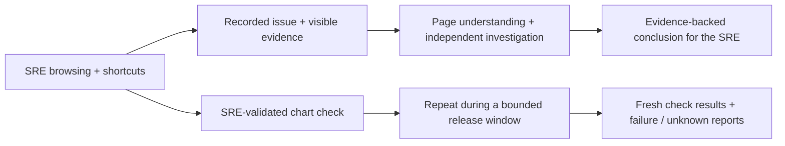

# LLM Bot Selenium

Help an SRE investigate an issue by understanding what they see in their browser—then reuse their validated checks for release monitoring. This complements the existing log-analysis tool; it does not replace it.

## Expected behavior

1. **Triage assistance:** observe an approved SRE browser session in Dynatrace, including navigation and shortcuts. Record the issue and visible page/chart context. The bot then follows its **own** browser investigation and returns an evidence-backed conclusion to assist the person—not a blind click replay.
2. **Reusable monitoring:** turn an SRE-validated check (“this chart looks fine”) into a building block: “check this chart every five minutes during this release and look for failures.” Keep the chart, entity, filters, expected condition and release window explicit.



**Status:** synthetic chart contracts now connect to a **loopback-only Selenium DOM adapter**: consented semantic navigation/shortcut submissions → visible numeric evidence → issue → separate-driver investigation → the same validated check in bounded release ticks. HTTP/fake-DOM tests pass; a two-browser acceptance test is included but blocked by missing binaries. No event listener or scheduler is installed. Actual browser execution and model-led understanding remain acceptance gates.

## Try the current prototype

Python 3.11+, from the repository root:

```sh
python -m venv .venv
. .venv/bin/activate  # Windows PowerShell: .venv\Scripts\Activate.ps1
pip install -r requirements.lock
python -m examples.chart_release  # connected synthetic SRE + release journey
python run_demo.py               # earlier learning/reuse harness
python -m unittest discover -s tests -v
```

The demo uses synthetic fixtures and a deterministic planner—not a live browser or LLM. It writes traces and reusable-workflow artifacts under `artifacts/demo`.

## Browser target: Edge

Supply an existing Edge binary and matching `msedgedriver`:

```sh
python browser_probe.py --browser edge --edge /path/to/msedge --driver /path/to/msedgedriver --run
```

On Windows, quote executable paths such as `"C:\Program Files (x86)\Microsoft\Edge\Application\msedge.exe"` and `"C:\tools\msedgedriver.exe"`. Chrome remains available with `--browser chrome --chrome /path/to/chrome --driver /path/to/chromedriver`. No automatic downloads, personal-profile reuse or sandbox bypass.

## Scope and evidence

- Latest local suite: **78 passed, 2 real-browser skipped**. Actual Edge/Chrome, Windows, SSO and live-model investigation are not validated here.
- Observe only consented pages. Do not record passwords, arbitrary keystrokes, cookies or tokens. The bot must not interfere with the SRE's browser.
- Missing/stale data, wrong context or an expired session must not be reported as healthy.
- The development cron builds these features; it does **not** enable a real five-minute production monitor or alerts.

[Chart DOM QA](docs/BROWSER_CHART_QA.md) · [Contract QA](docs/CHART_QA.md) · [Architecture and current boundaries](docs/ARCHITECTURE.md) · [Acceptance requirements](docs/REQUIREMENTS.md) · [Executed browser QA](EDGE_QA.md)

Tested feature PRs auto-merge into `blue-master`. Releases into `main` remain human-controlled.
