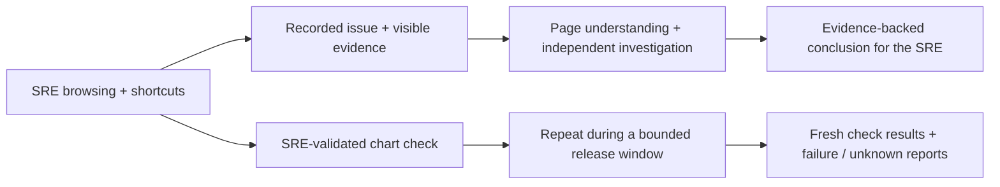

# LLM Bot Selenium

Help an SRE investigate an issue by understanding what they see in their browser—then reuse their validated checks for release monitoring. This complements the existing log-analysis tool; it does not replace it.

## DAG-first Workflow Studio — SRE Flow Builder

The canonical Python DAG now drives the canvas through a minimal validation/storage backend. [Run the backend + UI](docs/PYTHON_DAG.md#dag--ui-backend-authoritative-direction). It plans but never executes tasks. The existing LAN static demo is unchanged.

The editable frontend lives in **[`ui/`](ui/README.md)**. Start with `cd ui && npm ci --include=dev && npm run dev` (Node22+ and Python3 for artifact tests). The owner-hosted LAN demo is `http://smol-kitten.local:32085/`; it is not a public hosted service.

| Workspace component | What it does |
|---|---|
| Component library + graph | Search/drag actions; connect input/output handles or use explicit Connect to; conditional Yes/No branches, minimap, pan/zoom and ELK layout. |
| Node inspector | Edit targets, prompt, outputs and retry settings. Source is saved with each node. |
| **Python** tab | Config→Python starters, editable per-node `run(inputs, context=None)`, provenance/review, `.py` export and optional authenticated LLM code generation. Example: input `i`, condition `i > 3`. |
| **Record** button | Consented UI-authoring metadata capture; pause/resume/stop/export. Selenium browser recording is explicitly pending, not faked. |
| Browser / debugger / timeline | Clearly labelled fixture browser; one recorded demo event clock synchronizes graph states, logs and outputs. Real browser frames, network evidence and webpage perception remain pending. |
| History / persistence | Read-only historical graph snapshots, replay without infrastructure actions, backend-validated Save/Load DAG, separate local drafts/layout, bounded undo/redo and persisted panel dimensions. |

**Python-first functional DAG:** every canvas item now has a typed Python `Task`, explicit dependencies/routes, parameters, implementation text and loop-body scope. Uses existing stdlib **dataclasses + graphlib.TopologicalSorter**. Open **Task DAG** in the inspector or **DAG** in the canvas toolbar. Export Python functionality and JSON layout separately; safe Python/spec imports and plans do not execute handlers. [Framework choice, examples and CLI](docs/PYTHON_DAG.md). The DEMO/Triage overlap and full-width canvas constraints are also fixed structurally; visual browser acceptance remains pending.

**Latest design expansion (unmerged):** structured `for`/`while` bodies with Continue/Repeat and DONE exits; explicit IF/ELSE paths; a recorded/live-triage URL/clickpath clipping designer and reusable snippet library; all five VS Code-style pane dividers. See the [control-flow, snippets and divider walkthrough](ui/README.md#control-flow-and-triage-design-expansion-pr11-review-hold). Snippet execution/live transport remains pending.

The frontend never runs custom or generated Python. The Python counterpart [`triage/studio_python.py`](triage/studio_python.py) validates syntax and exports review-only modules; constrained branch evaluation does not use `eval`. A configured LLM adapter can return a candidate for human review; no provider is enabled by default. Webpage perception and selector discovery are pending.

**Screenshots: blocked in this runtime, not fabricated.** Chromium cannot start with a usable sandbox and an alternate browser download timed out. [`ui/scripts/capture_screenshots.py`](ui/scripts/capture_screenshots.py) captures actual workspace, Python-inspector and recording-dialog PNGs on a sandbox-capable loopback environment. No empty/broken screenshot links or illustrations are presented as real screenshots. See the [component-by-component guide and capture instructions](ui/README.md).

**Local checks:** 95 frontend tests passed, including real-Python parsing of frontend-generated artifacts; TypeScript/Vite build passed. Python regression suite: 97 tests run, 95 passed and 2 actual-browser tests skipped. No live Selenium recording, LLM inference, production infrastructure execution or visual screenshot acceptance is claimed.

### Offline CLI page seeds

With Node22.18+ and UI dependencies installed:

```sh
cd ui
npm run seed -- open 'https://example.com/services/{service}?query={xyz}' --output page.json
```

Upload `page.json` using **Run History → Import workflow JSON** in the active editor (save the current draft first). Creates a reusable **offline** snippet with empty parameter bindings; no page/model is invoked and demo execution stops **Pending**, not success. Output never overwrites an existing file. Use synthetic URLs; command-line input can appear in shell history. [Usage, architecture, actual test evidence and limitations](docs/PAGE_SEED_QA.md).

### Consented observer metadata → Studio snippets

The existing loopback Selenium chart adapter can now export a stopped SRE issue as `triage-session/v1` metadata with separate export consent. Import it in **Triage**, clip navigation/semantic shortcuts, and add a reusable snippet to the native graph. WebDriver IDs, binding queries and chart values stay out of exports; full issue evidence still serves independent investigation and bounded release checks. Imported paths remain unverified and execution **Pending**, not fabricated video or browser success. [Usage, architecture and executed evidence](docs/OBSERVER_STUDIO_QA.md).

## Expected behavior

1. **Triage assistance:** observe an approved SRE browser session in Dynatrace, including navigation and shortcuts. Record the issue and visible page/chart context. The bot then follows its **own** browser investigation and returns an evidence-backed conclusion to assist the person—not a blind click replay.
2. **Reusable monitoring:** turn an SRE-validated check (“this chart looks fine”) into a building block: “check this chart every five minutes during this release and look for failures.” Keep the chart, entity, filters, expected condition and release window explicit.



**Status:** synthetic chart contracts now connect to a **loopback-only Selenium DOM adapter**: consented semantic navigation/shortcut submissions → visible numeric evidence → issue → separate-driver investigation → the same validated check in bounded release ticks. HTTP/fake-DOM tests pass; a two-browser acceptance test is included but blocked by missing binaries. No event listener or scheduler is installed. Actual browser execution and model-led understanding remain acceptance gates.

## Try the current prototype

Python 3.11+, from the repository root:

```sh
python -m venv .venv
. .venv/bin/activate  # Windows PowerShell: .venv\Scripts\Activate.ps1
pip install -r requirements.lock
python -m examples.chart_release  # connected synthetic SRE + release journey
python run_demo.py               # earlier learning/reuse harness
python -m unittest discover -s tests -v
```

The demo uses synthetic fixtures and a deterministic planner—not a live browser or LLM. It writes traces and reusable-workflow artifacts under `artifacts/demo`.

## Browser target: Edge

Supply an existing Edge binary and matching `msedgedriver`:

```sh
python browser_probe.py --browser edge --edge /path/to/msedge --driver /path/to/msedgedriver --run
```

On Windows, quote executable paths such as `"C:\Program Files (x86)\Microsoft\Edge\Application\msedge.exe"` and `"C:\tools\msedgedriver.exe"`. Chrome remains available with `--browser chrome --chrome /path/to/chrome --driver /path/to/chromedriver`. No automatic downloads, personal-profile reuse or sandbox bypass.

## Scope and evidence

- Latest local suite: **78 passed, 2 real-browser skipped**. Actual Edge/Chrome, Windows, SSO and live-model investigation are not validated here.
- Observe only consented pages. Do not record passwords, arbitrary keystrokes, cookies or tokens. The bot must not interfere with the SRE's browser.
- Missing/stale data, wrong context or an expired session must not be reported as healthy.
- The development cron builds these features; it does **not** enable a real five-minute production monitor or alerts.

[Chart DOM QA](docs/BROWSER_CHART_QA.md) · [Contract QA](docs/CHART_QA.md) · [Architecture and current boundaries](docs/ARCHITECTURE.md) · [Acceptance requirements](docs/REQUIREMENTS.md) · [Executed browser QA](EDGE_QA.md)

Tested feature PRs auto-merge into `blue-master`. Releases into `main` remain human-controlled.


## Test-mode generator and Selenium Grid

Opt-in backend generation uses Smol Friend **Qwen3.6-35B-A3B Q4**, returning review-only candidates for saved DAG tasks. A private single-instance Selenium Grid manifest and synthetic smoke CLI are included. [Run instructions, actual evidence and deployment blockers](docs/TEST_RUNTIME.md). Existing LAN/static hosting is not silently upgraded; no generated code or real-site workflow is executed.
