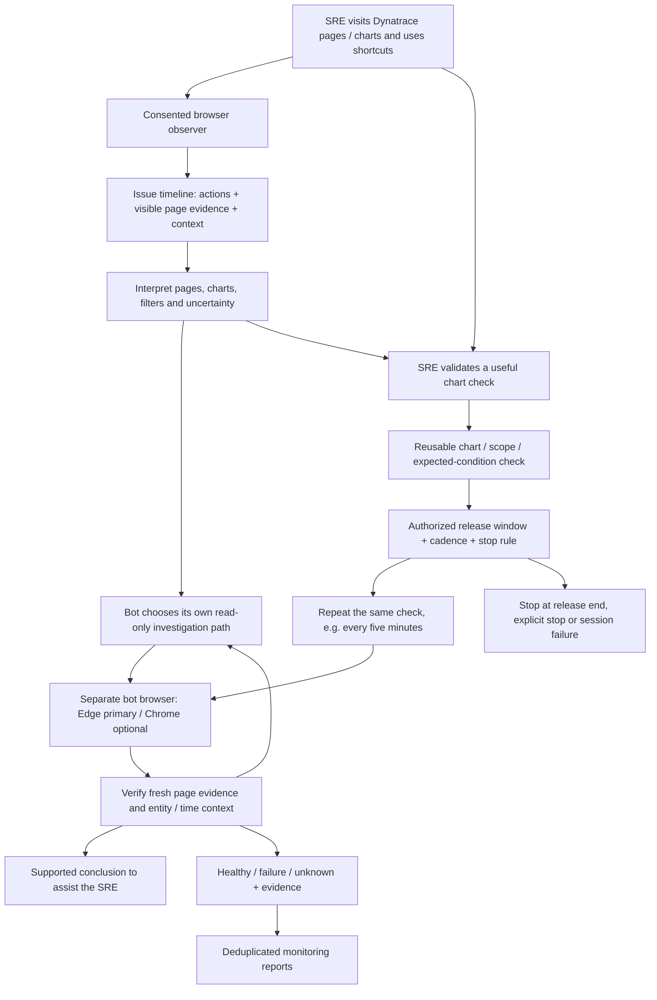
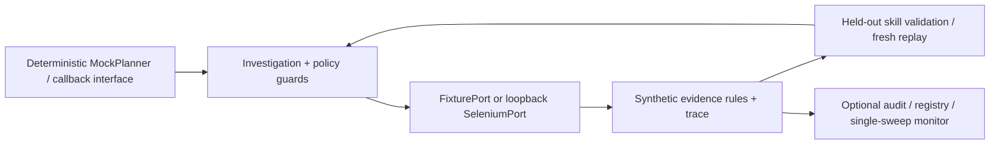

# Architecture

## Target product: assist first, reuse for monitoring second

This is the **required behavior**, not a diagram of already completed functionality. The semantic observer/issue/check/release contracts have a deterministic synthetic implementation below. The chart Selenium adapter is now implemented for loopback fixtures; rendered browser execution, automatic semantic event observation and grounded model interpretation remain acceptance work. An SRE's private reasoning is not observable; conclusions must be supported by page evidence or explicit annotations.

## Implemented connected synthetic slice

```mermaid
flowchart LR
    Person["Isolated synthetic SRE WebDriver"] --> DOM["SeleniumChartPort.capture: scoped visible chart only"]
    Input["Explicit consent + semantic navigation / shortcut submission"] --> DOM
    DOM --> Observer["SyntheticObserver: no listener or raw key capture"]
    Observer --> Issue["Immutable issue timeline + typed ChartView"]
    Issue --> Check["SRE validation + explicit maximum -> ChartCheck"]
    Issue --> Interpret["Numeric page interpretation: NOT an LLM"]
    Check --> Investigate["investigate_chart: choose alternate route"]
    Interpret --> Investigate
    Investigate --> Bot["SeleniumChartPort.read_chart: separate WebDriver session ID"]
    Bot --> UI["Loopback mock_server chart routes / visible numeric DOM"]
    UI --> Bot
    Bot --> Guard["Existing Policy + chart / label / filters / sample checks"]
    Guard --> Result["Evidence-backed healthy / failure / unknown"]
    Check --> Plan["ReleasePlan: start / end / 300-second cadence"]
    Plan --> Tick["ReleaseMonitor.tick: injected clock, no scheduler"]
    Tick --> Bot
    Result --> Dedupe["Per-release state-transition dedupe + report flag"]
    Tick --> Stop["End / explicit stop / expired session"]
```

`triage/chart_checks.py` reuses `core.Policy`, `Context` and the existing read-only `Action` allowlist. Typed chart evidence deliberately has no raw text, URL, keypress or credential field. The sample clock and capture clock must both be fresh; the exact entity, fixed time window, chart label, filters and UI contract must match. The baseline chooses an alternative dashboard/entity route rather than replaying the observer's actions. `examples/chart_release.py` uses an in-memory synthetic reader—not Selenium or model inference. `triage/chart_browser.py` now wires the same contracts to loopback chart DOM, reusing `SeleniumPort` origin checks, bounded explicit waits and navigation. Session isolation uses WebDriver's actual session ID, not a caller alias. `capture` never navigates the person's driver; the caller explicitly submits only allowlisted semantic actions. The adapter reads one visible numeric element and bounded typed metadata, not page text/cookies/keys. `mock_server` renders the chart, scope and an unrelated misleading-text decoy. This is a synthetic DOM contract, not a Dynatrace adapter or automatic shortcut listener.

| Added files | Responsibility |
| --- | --- |
| `triage/chart_browser.py` | Loopback visible chart reader, consent-first semantic capture, actual driver session identity. |
| `triage/mock_server.py` | Chart routes with typed metadata, visible numeric sample and controllable synthetic chart state. |
| `tests/test_chart_browser.py` | Genuine HTTP + fake DOM for both connected journeys and invalid/expired evidence; NOT rendering. |
| `tests/test_selenium_browser.py` | Opt-in two-isolated-browser chart journey and bounded release; currently skipped. |
| `triage/chart_checks.py` | Consented semantic capture, issue/check contracts, alternate-route investigation and bounded release ticks. |
| `tests/test_chart_checks.py` | Both synthetic journeys, privacy/action gates, freshness/context/drift/session/stop and failure/unknown/dedupe cases. |
| `examples/chart_release.py` | Executable connected journey with fake timestamps; prints evidence JSON. |
| `docs/REQUIREMENTS.md`, `docs/CHART_QA.md` | Product acceptance and honest executed/blocked evidence. |

## Existing prototype

| Existing code | What it supplies—not an end-to-end acceptance claim |
| --- | --- |
| `triage/core.py` | Policy, planner callback, synthetic diagnosis, traces and validated workflow reuse. |
| `triage/browser_runtime.py`, `browser_probe.py` | Explicit Edge/Chrome setup, isolated profiles and runtime acceptance reports. |
| `triage/selenium_port.py`, `triage/mock_server.py`, `triage/fixtures.py` | Synthetic page contract and fixture evidence; no real Dynatrace adapter or SRE observer. |
| `triage/audit.py`, `triage/registry.py` | Optional local audit and skill storage. |
| `triage/monitor.py`, `triage/weekend.py` | Monitoring/dedupe primitives; no complete chart-derived release monitor or installed scheduler. |
| `tests/`, `evaluate.py`, `run_demo.py` | Fixture regressions, opt-in browser tests and synthetic demonstrations. |

Current evidence: **78 tests passed, two real-browser tests skipped**; 60/60 synthetic reuse pairs and healthy counterexamples correct. Actual Edge/Chrome/Windows, live-model page understanding, SSO and both complete user journeys remain unvalidated. Legacy monitor deadline/context and async-page limitations remain; see [chart QA](CHART_QA.md) and [browser QA](../EDGE_QA.md).

Next work follows [acceptance requirements](REQUIREMENTS.md). No live recording, production monitoring or data egress is enabled by this documentation. The separate existing log-analysis tool is not reimplemented here.
