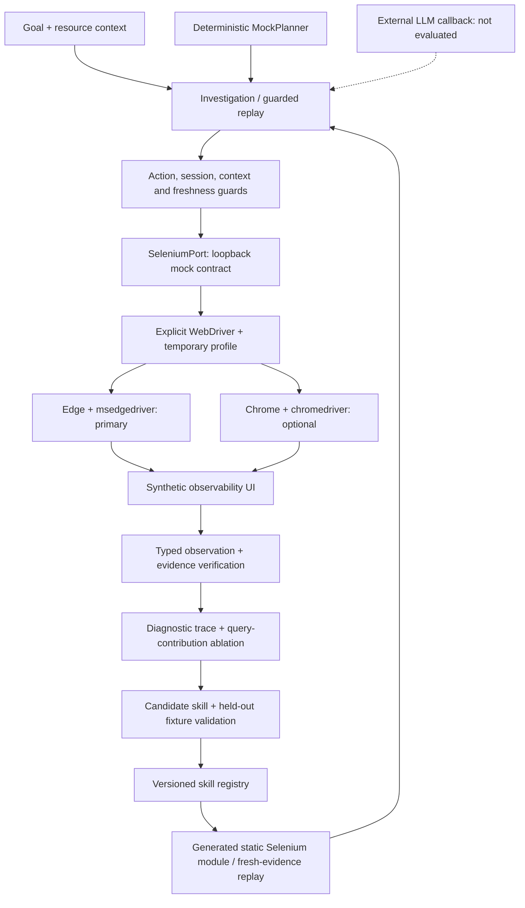

# Architecture

Synthetic investigation → verified evidence → reusable Selenium workflow.

## Investigation and reuse

The driver factory requires existing executable paths: it does not download drivers, reuse personal profiles or disable sandboxing. `SeleniumPort` accepts only the local mock origin; it is not a Dynatrace/CloudWatch adapter. Page content is data, not executable instructions.

## What each piece does

| Files | Responsibility |
| --- | --- |
| `triage/core.py` | Planner interface, policy, evidence verification, trace/skill lifecycle and static workflow export. |
| `triage/selenium_port.py` | Read-only controls and explicit waits for the synthetic UI contract. |
| `triage/browser_runtime.py` | Select Edge or Chrome; create an explicit Service and isolated browser options. |
| `browser_probe.py` | Detect runtime availability; run the browser acceptance test and record blocked/pass/fail artifacts. |
| `triage/mock_server.py`, `triage/fixtures.py` | Local UI and synthetic incidents; no real cloud connection. |
| `triage/audit.py`, `triage/registry.py` | Query audit and versioned local skill storage. |
| `triage/monitor.py`, `triage/weekend.py` | Synthetic resource sweep, dedupe and weekend-policy prototype; no installed scheduler or alert sender. |
| `tests/`, `evaluate.py` | Regression tests, opt-in real-browser test and deterministic cold/reuse evaluation. |

## Evidence boundary

**Executed:** 57 tests passed; one real-browser test skipped. Edge and Chrome constructor wiring uses real Selenium options/services with mocked launches.

**Not demonstrated:** real Edge/Chrome execution, Windows execution, actual LLM-led investigation, internal SSO or production monitoring. Both browser probes are blocked because binaries are missing. Model access for development/review is not an agent-inference benchmark.

Freshness and evidence checks are prototype rules over synthetic data, not production security certification. Known monitoring deadline/context defects and asynchronous-page limitations remain in the [README](../README.md). Runtime validation details: [EDGE_QA.md](../EDGE_QA.md).
