# DAG → browser → grounded LLM action → private recording

The connected **test** path runs one saved browser task in isolation. It is not an arbitrary Python executor, full DAG scheduler, production bot, or permission to record a private/SRE session.

```mermaid
flowchart LR
  Python[Canonical Python DAG + explicit browser policy] --> UI[Saved policy / consent / Run and Record]
  UI -->|task ID + exact revision + consent| Backend[Bounded background run]
  Backend --> Grid[Fresh isolated Selenium Grid browser]
  Grid --> Region[Approved URL / marked visible region]
  Region --> Qwen[Local Qwen / untrusted page evidence]
  Qwen --> Proposal[Candidate ID + evidence hash]
  Proposal --> Guard[Allowlist / stale page / revision / cancellation checks]
  Guard --> Click[Fixed Selenium click tool]
  Click --> Assert[Fresh visible expected-result assertion]
  Assert --> Record[Private action ledger + redacted region frames]
  Record --> Replay[Selected-action replay / optional action-frame WebM]
  Record --> Snippet[Existing triage-session export / reusable snippet]
```



## Setup

For the current shared UI connection, public read-only policy, debugger/history wiring and actual dispatch evidence, see [UI_GRID.md](UI_GRID.md). The annotated action/capture path described below remains unchanged.

1. An operator deploys the private Grid **and fixture** together: `kubectl apply -k deploy/`. The Kustomize ConfigMap supplies the two static fixture pages; the additional non-root Python HTTP sidecar binds only127.0.0.1:8080 inside the Grid pod. Browser egress stays denied. The URL resolves in the **browser's pod**, not the backend. No public fixture port, SSO, host profile or network-policy bypass.
2. Build `ui/` using the existing Node22 workflow; install the existing Python lockfile into a local venv for Selenium. Optional frame-video export needs an existing `ffmpeg` with `libvpx-vp9`; it is not downloaded automatically.
3. Initialize a canonical example only if needed, preserving any existing DAG:

```sh
mkdir -p runtime
cp -n examples/browser_dag.py runtime/browser_dag.py
SELENIUM_GRID_URL=http://selenium-grid.llms.svc.cluster.local:4444 \
  python -m triage.dag_server --dag runtime/browser_dag.py --port 3031 \
    --recordings runtime/browser-recordings --test-mode
```

4. Open localhost3031, select the saved browser task, and use **Run & Record**. Review its saved URL, goal, allowed controls and expected result. Explicit consent covers approved read-only clicks, sending the marked visible region to local Qwen, and private frame/action capture. Unsaved canvas changes are not authority; Save/reload the policy first. A changed revision returns409.
5. Run. The backend creates a separate Grid session, checks the real browser sandbox arguments, opens the saved URL, observes the approved region, asks Qwen for a structured action, checks the fresh page/revision, persists the intent, clicks a validated control, then records/validates the outcome. Expected visible text—not an LLM success claim—determines pass. Generated Python is never imported or run.
6. Select an action to see its recorded frame, selector, evidence hash and completion state. Export the private recording JSON, or its existing `triage-session/v1` metadata and import that in **Triage** to clip a reusable snippet. Imports remain labelled unverified; recording a path does not automatically authorize replay execution.

## Canonical policy and page boundary

`examples/browser_dag.py` is a real backend-authored definition. A task's `params.target` is its URL, `params.prompt` its goal, and `params.browser` contains:

- `allowed_actions`:1..20 stable `data-sre-action` IDs, not a hard-coded action sequence.
- `expected`: `{id, text}` for one visible `data-sre-result` element.
- `max_steps`:1..5 model-selected clicks, with a checked300-second work budget. In-flight bounded model calls can finish after that budget/cancellation before cleanup.

The default approved URLs are exactly `http://127.0.0.1:8080/` and `/details.html`. An administrator can configure `SRE_BROWSER_URLS` as a JSON list of1..10 explicit approved HTTP(S) URLs. Credentials, query strings and fragments are rejected. This setting alone does **not** authorize private sites or relax the Grid's egress policy. Additional site/data/model-boundary approval, a trusted adapter and operator network policy are required before broader use.

Pages must expose exactly one visible `data-sre-observe` region. Actionable buttons/links must be marked `data-sre-safe="true"`, have an allowlisted `data-sre-action` ID and a visible non-destructive label; links must resolve to an approved URL. The LLM chooses among grounded candidates rather than following a prescribed click path. It cannot invent a selector, navigate to a new URL, type into fields, submit forms, execute scripts, run generated source or expand its own permission list.

Observation excludes forms, inputs, textareas, selects, editable/private elements and hidden text; the expected-result read uses that same filtered snapshot. Frames capture only the marked region, temporarily masking private/form elements and bounding dimensions. This is an explicit trusted test-page capture boundary, **not automatic PII detection for arbitrary websites**. No cookies, storage, arbitrary key events, full page source, WebDriver session IDs or original SRE browser sessions are recorded. Page text is untrusted model evidence, never system instructions.

## Recording, replay and cancellation

- Private `browser-run/v1` manifests record the canonical task/revision, approved goal/policy, model attempts, grounded observations/proposals, timestamped action intent/completion, source/landing URLs, visible assertion, bounded frames and final status.
- Intent and before-frame are stored **before** clicking. Missing capture/storage, fabricated candidates, stale pages/DAGs and unsupported model completion stop the run. A post-click capture failure records an uncertain/performed action, not success.
- **Cancel** immediately prevents subsequent actions once observed by the worker. An in-flight model/driver request may finish before cleanup; closing the panel is not cancellation. The isolated browser always receives a quit attempt in `finally`; Grid idle-session expiry300seconds handles backend-process failure. Interrupted runs are not resumed automatically.
- Optional WebM is an **action-frame replay**,1second per captured frame, not continuous real-time browser video. It uses the actual stored region frames; no animation/screenshot is invented. Selected-action video offsets refer to this frame timeline, while event timestamps retain actual elapsed time. Continuous desktop recording is not claimed.
- Storage is owner-only, bounded to20 runs /100MiB with per-frame/image/video limits. No automatic deletion of old user recordings; archive them deliberately when capacity is reached. Assets are served only through validated opaque-ID routes, same-origin checks and private-content headers, never the public static directory.

## API

All endpoints retain the local Host/origin boundary and require `--test-mode`:

- `POST /api/browser/runs`: JSON `{nodeId, consent: true, video: boolean}`, `If-Match: <canonical revision>`. Returns202 with opaque ID. No client URL/selector/policy/source overrides. Grid/storage/video preflight fails503 before opening a browser.
- `GET /api/browser/runs`: bounded private history; `GET /api/browser/runs/{id}`: progress/recording.
- `POST /api/browser/runs/{id}/cancel`: request cancellation.
- `GET /api/browser/runs/{id}/frame-NN.png` or `/actions.webm`: only manifest-listed bounded recording assets; no arbitrary file path or uploads.

The single backend process serializes model operations and allows one browser run. DAG reads/saves remain responsive; changing canonical functionality stops the run before another click. Function-generation candidates stay review-only. Test status reports consented browser-action capability separately from `generatedPythonExecution: false` and actual Grid readiness.

## Evidence and remaining infrastructure gate

Current Edge Grid setup and live startup evidence: [EDGE_GRID.md](EDGE_GRID.md). The public-site CLI example is a separate read-only check, not permission to run the recording/model adapter on unannotated public pages.

Deterministic tests exercise the full controller/HTTP/recording/reusable-schema path with a **simulated WebDriver**: consent, policy, invented action, stale page/DAG, private root, false finish, capture failures, cancellation, sandbox refusal, capacity, restart handling and cleanup. A cross-language test passes actual Python recording output through the active TypeScript triage/snippet parser. Actual ffmpeg encodes simulated test frames; those are not real-browser screenshots.

A real local Qwen inference selected a grounded action and completed the controller plus frame-video export against a **simulated WebDriver**, explicitly labelled `SIMULATED_WEBDRIVER_WITH_REAL_QWEN`. This does not pass the real-browser gate. `RUN_GRID_BROWSER_LOOP=1 python -m unittest discover -s tests -p test_browser_loop.py -v` includes the explicit real Grid+Qwen+fixture acceptance test; it must actually pass after deployment on a sandbox-capable node. Screenshots/private-mask rendering and physical UI interactions remain live-browser acceptance items.

At the original implementation checkpoint, this environment could not reach the Kubernetes API and had no deployed Grid DNS/container runtime. The manifest has parsed/referenced-file checks, not API admission or a deployment receipt. The local test backend can serve the new UI/API, but opening an actual Grid browser remains blocked. The existing OpenCode/LAN3001 deployment is not silently replaced or publicly exposed.
