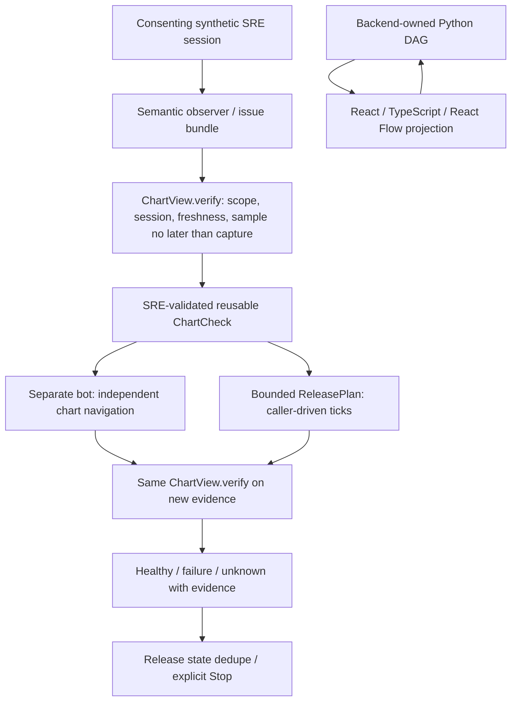

# Chart sample/capture chronology

A fresh capture cannot attest to a sample timestamp later than that capture.
Previously, sample=101, capture=100, evaluation=101 passed both independent
freshness checks and could produce a healthy/failure conclusion. The shared
`ChartView.verify` now also requires `sample_at <= captured_at`. No clock skew
is guessed or silently corrected: inconsistent evidence remains unknown.



## File walkthrough

- `triage/chart_checks.py`: shared sample chronology guard, reused at check
  creation, independent investigation, and release evaluation; zero net new
  production lines, no dependencies or new runtime.
- `tests/test_chart_checks.py`: rejects inconsistent healthy and failure values
  in both journeys; retains unknown evidence references/dedupe; accepts samples
  equal to or earlier than capture; still rejects stale samples.
- `tests/test_chart_browser.py`: real loopback HTTP + fake DOM adapter regression
  for SRE validation, independent navigation and bounded release recovery.

## Run from repository root

```sh
python -m unittest discover -s tests -v
python evaluate.py
python -m examples.chart_release
cd ui
npm ci --include=dev --no-audit --no-fund
npm test
npm run build
```

## Boundaries

The observer may retain inconsistent evidence in an issue; it cannot become a
validated check or a numeric conclusion. Existing scope, timestamps, consent,
expiry, replay/dedupe, cancellation and release bounds remain active. Production
clock domains must be normalized by an approved adapter before acceptance, not
by weakening this check. This is not real-browser/model/video acceptance, a
scheduler, an executor or a deployment. Backend-first Studio ownership is unchanged.
