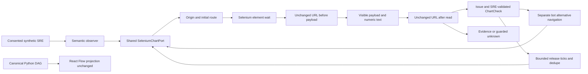

# Reject chart navigation during evidence collection

The loopback chart adapter previously checked the requested path only before its
Selenium wait. Same-origin navigation during the wait or payload/text reads could
attach an old chart element to a new page, including a login page. The adapter now
retains the initial complete URL and rejects changes both before reading chart
payload and after collecting payload/text. Existing origin, binding, visibility,
freshness, session and replay guards remain intact. No new dependency or API.

## Files
- `triage/chart_browser.py`: capture initial URL; reject navigation at both read
  boundaries. Five net production lines, no new abstraction. Query changes count
  as context changes even if the path stays the same.
- `tests/test_chart_browser.py`: nine wait/payload/text × alternate-chart/login/
  changed-query regressions; no issue event on rejection and no payload reads when
  navigation was observed after waiting. Connected independent-investigation and
  release tests return unknown, leave evidence dedupe unchanged, and recover with
  a stable fresh page. Actual loopback HTTP, Selenium waits and fake DOM only.

## Actual evidence (2026-10-25)
- Before fix: 10 failing assertions across the two new tests.
- `python -m unittest discover -s tests -v`: 167 run, 162 passed,
  five opt-in actual-browser tests skipped.
- `python evaluate.py`: 60/60 diagnoses and 60/60 healthy counterexamples.
- `python -m examples.chart_release`: connected deterministic UC1/UC2 passed.
- `cd ui && npm ci --include=dev --no-audit --no-fund && npm test`:
  167 frontend tests passed; `npm run build`: TypeScript/Vite passed, existing
  bundle-size advisories remain.
- Python compilation and whitespace checks passed.

## Limits
This is a boundary URL check, not an atomic browser snapshot: same-URL DOM changes,
or navigation away and back between checks, are not detected. Existing typed
binding/freshness/session guards still apply. It does not forcibly cancel a driver,
install a monitor, change Grid isolation, record people or deploy anything.
Actual model/browser/video and physical UI were not run in this change. Full
UC1/UC2, Studio execution/parallelism and owner handoff remain open. Owner-local
UI/Grid work is preserved and not implicitly published by this narrow PR.
