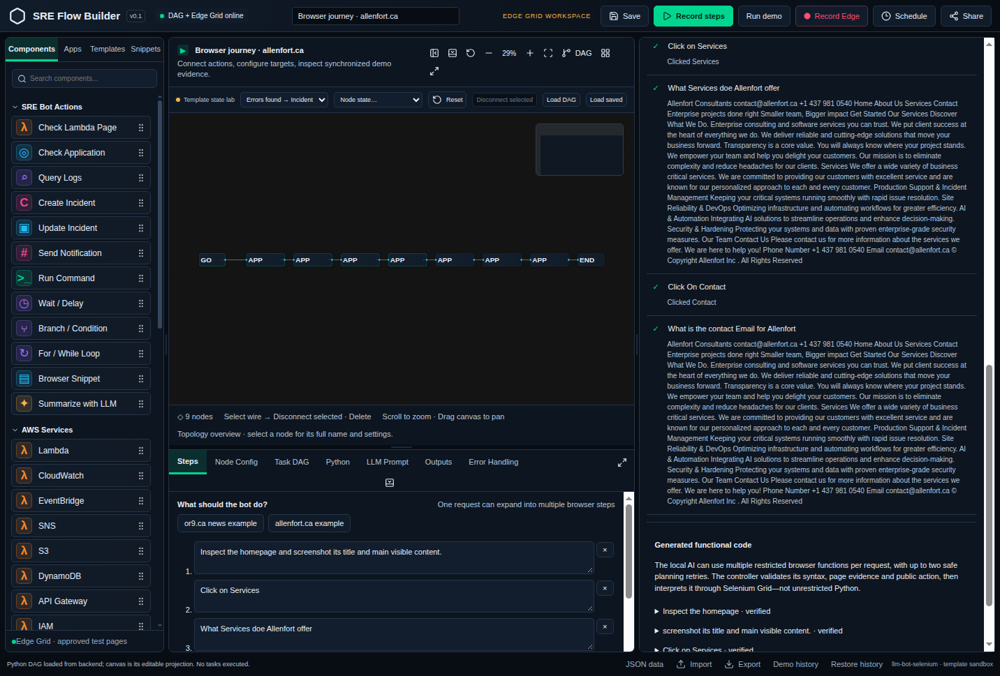
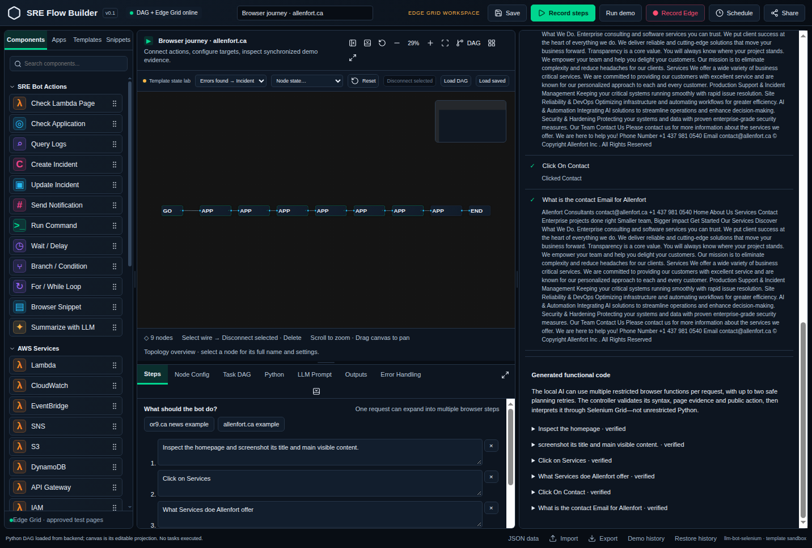
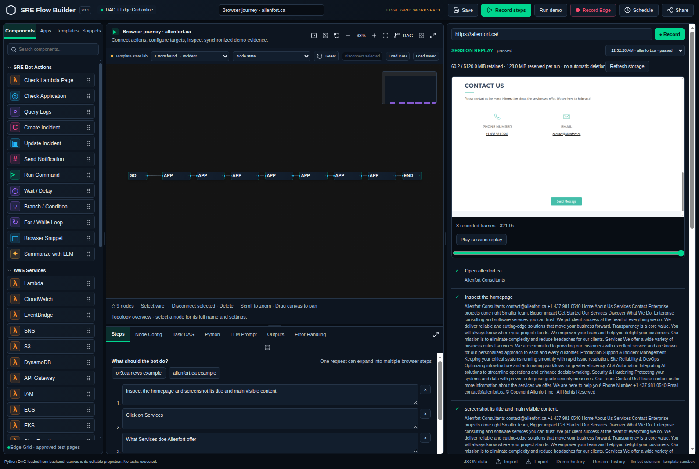
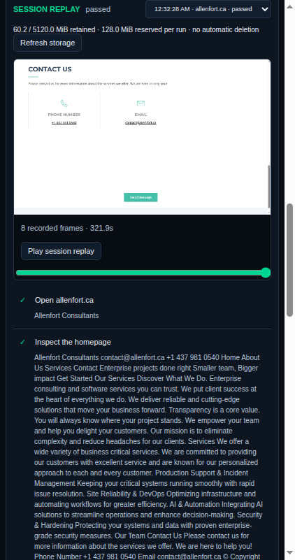

# Services/Contact click fix — fresh actual product demonstration

Issue63: https://github.com/orionnelson/llm-bot-selenium/issues/63

## Outcome

The normal authenticated Studio Record flow now completes the owner public journey: inspect/screenshot Allenfort, Click on Services, read service content, Click On Contact, read public contact email. Both real Selenium clicks reached the expected /#services and /#contact fragments; actual Session Replay was reopened and rendered passed. No website form submission or email sending.

## Fresh affected-component captures

## Exact tested variant and assertions

- Grid Microsoft Edge155.0.4283.45; desktop1600x1200, step components1440x1100, mobile430x932. Mobile evidence is terminal rendering, not a separate mobile-input end-to-end run.
- Deployed owner backend SHA25641c730e1ea67af09ffafb5fe13a8d8bc8a210ae10b1e56fea1f59cdda8cea4e6; frontend bundle index-6i1lRLWs.js. Canonical saved workflow and51priorrecordings unchanged. One explicitly requested public test recording added.
- Run f8fff0719f844836a734a7b3bc3da5cb; navigation plus six expanded instruction steps verified, six real model calls, eight recorded frames, ~321.9seconds.
- Grid has one slot. UI controller clicked the real Record button, closed to free the slot for the application journey, then reopened the terminal run through normal controls. Metadata polling did not substitute for initiating/inspecting the UI.
- Authentication used origin-scoped CDP auth challenge handling; no credentials in URLs/global headers. Existing container isolation, public URL/consent/private-data protections unchanged; no forced JS click. Owned sessions quit.
- The deployed owner variant includes other existing journey features not in PR61. The fixed parser/exact-label/model-choice logic is shared, but these screenshots do NOT claim exact-PR61 new Airflow controls or worker acceptance.
- PR candidate journey source SHA2569a5c15901a3b3350e68295f58de35896d050e0332eee8233a4698439c5c213bd; byte-for-byte matches the locally tested candidate source.

## Small change / tests

Share existing target parsing, consume optional grammatical on only immediately after click, prefer unique exact labels among already observed candidates, and restrict proposed click operations to that chosen candidate set. Keep missing/ambiguous target rejection, exclusions, wrong-selected guard and mailto refusal. Do not remove redaction to work around grammar. No new dependency.

Executed from the source root: python -m unittest discover -s tests -p test_click_on_target.py -v:11PASS. Full python -m unittest discover -s tests -q:303total,298PASS/5opt-inbrowserSKIP. Deployed11-case suite passed separately. Before fix, targeted tests reproduced the target-not-observed error. Actual UI result above is separate from unit/fake/HTTP evidence. New PR exact-head CI must run; old-head green checks do not apply.

## Separate review and open gates

[ses_e32c97195ffea6Yc4awkWDZ2ZV read-only independent review](https://github.com/orionnelson/llm-bot-selenium/issues/62#issuecomment-6811022144) found no blocking narrow-code defect. Two P3follow-ups: show requested answer before long page evidence, and provide mobile frame zoom/full-size view. No unrequested redesign applied.

Issue62 remains open: exact-PR61 rendered Airflow controls->actual worker terminal->rendered result, Selenium in the actual replay worker, running-browser Stop/cleanup and broader component review are not established by this public journey. Do not merge PR61 based on these screenshots/CI alone. Main remains human-controlled.
