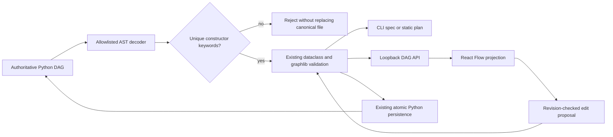

# Reject ambiguous Python DAG constructor fields

The backend Python definition is authoritative. Its restricted AST decoder must not interpret duplicate constructor keywords differently from Python: `ast.parse` accepts them, while compilation rejects them. Previously the decoder's dictionary comprehension silently kept the last value. A reviewed name, task ID, loop mode or implementation source could therefore be hidden by a second keyword.

## Architecture



No new parser/framework/dependency. The shared decoder checks uniqueness before constructing any DAG, Task, LoopSpec or PythonSource. Existing dictionary-key, arbitrary-code, graph and consent checks stay intact. Inert implementation strings remain strings.

## File walkthrough

- `triage/dag.py`: two production lines reject duplicate constructor keyword names in the existing decoder.
- `tests/test_dag.py`: all four constructor types plus a real CLI subprocess that must not create output for ambiguous source.
- `tests/test_dag_server.py`: actual HTTP GET refuses to project ambiguous server-owned Python; a PUT cannot overwrite it.
- `ui/src/backend.test.js`: real Python HTTP backend + TypeScript client rejects the ambiguous definition instead of projecting a last-value-wins canvas; restores fixture source afterward.
- `docs/PYTHON_DAG.md`: links this regression evidence.

## Executed 2026-10-21

Before the fix, focused Python suite: 23 tests, six assertion failures (four constructor subcases, CLI, HTTP). After the fix:

```sh
../demo/.venv/bin/python -m unittest discover -s tests -v
../demo/.venv/bin/python evaluate.py
PYTHONPATH=. ../demo/.venv/bin/python examples/chart_release.py
cd ui && npm ci --include=dev --no-audit --no-fund
npm test
npm run build
```

- Python: 117 run, **115 passed / 2 actual-browser skipped / 0 failed**.
- Frontend: **133 passed / 0 failed**; TypeScript + Vite build passed (existing large-bundle advisories).
- Evaluation: 60/60 synthetic diagnosis pairs and 60/60 healthy counterexamples correct; connected synthetic SRE assistance + reused bounded chart-check example passed.
- Parent reviewed the shared-call-site impact and minimal diff; independent native reviewer unavailable due gateway-token mismatch, not claimed successful.

These are actual unit/HTTP/subprocess/cross-language executions with synthetic data, not rendered-browser, video, model or production acceptance. No live recording, monitor, deployment, scheduler, arbitrary Python execution or browser-security change. The loopback backend retains its single-process ownership limitation. Full browser/model/Studio execution and handoff gates remain open.
