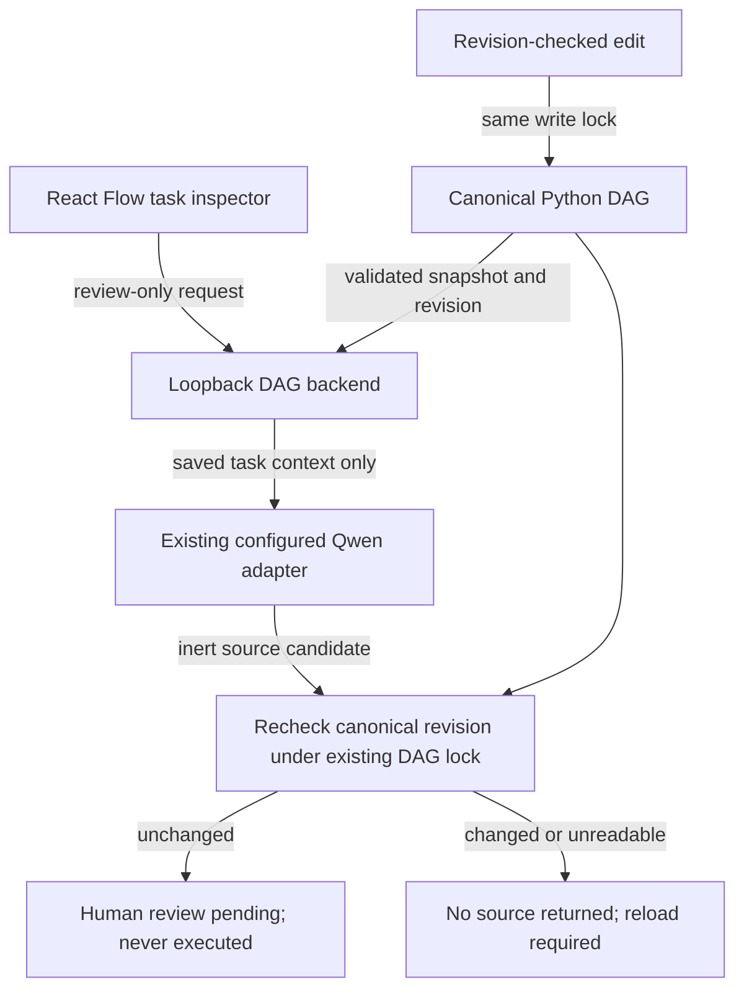

# DAG-owned generation: reject obsolete candidates

A model request can outlive a canonical task edit. Previously the backend returned a successful candidate for the old predicate even after a revision-checked PUT saved a new predicate for that same task ID. The UI's local-node-change guard cannot detect an edit made by another client.

The backend now retains the existing snapshot revision, then revalidates the canonical file after generation. A different valid revision returns HTTP 409 with no candidate. Invalid/missing canonical source returns the existing fail-closed HTTP 502 with no candidate. The existing DAG write lock serializes the final check/response against this process's PUTs; slow model generation does not hold that lock. The existing generation lock is always released. No new endpoint, dependency, execution capability or persistence path.



## File walkthrough
- `triage/dag_server.py`: retain snapshot revision; recheck after generation before responding, using the existing write lock/error handling.
- `ui/src/PythonInspector.tsx`: 409 explains reload/save rather than merely suggesting Save for an already-saved obsolete task.
- `tests/test_test_integrations.py`: real HTTP server + Event-coordinated request thread, mocked model only. Change the saved task predicate using actual PUT or external file edit; also invalidate/delete the file. Assert obsolete source is absent, canonical file is not overwritten and a subsequent request succeeds. Unchanged source still returns the review-only candidate.

## Executed evidence
Four pre-fix failures reproduced (PUT, external edit, invalid source, missing source incorrectly returned HTTP 200). Final full Python suite: 155 tests, **152 PASS, 3 actual-browser SKIP**, zero failures. Frontend: **162 PASS**, TypeScript/Vite build PASS (existing large-bundle advisory). Existing 60/60 deterministic diagnoses plus 60/60 healthy counterexamples and executable connected synthetic UC1/UC2 example pass.

```sh
../demo/.venv/bin/python -m unittest discover -s tests -v
../demo/.venv/bin/python evaluate.py
../demo/.venv/bin/python -m examples.chart_release
../demo/.venv/bin/python -m compileall -q triage tests
cd ui && npm ci --include=dev --no-audit --no-fund && npm test && npm run build
```

## Limits
Tests use actual loopback HTTP and threads, not actual model inference or rendered-browser execution. No shared-model calls, live recording, Grid deployment, LAN upgrade, production monitor or main release. Existing running backend is untouched. This protects changes during generation, not a new client-side If-Match protocol for initially stale clients. Existing single-process file ownership remains required: an unrelated external writer is not coordinated by a Python thread lock, and identical restored content has the same content revision. Browser/model/video/full UC1/UC2 and Studio handoff acceptance remain open.
