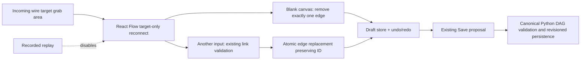

# Disconnect/reconnect from the left input socket

Grab an existing wire at its destination node's left-hand input socket. Drop on blank canvas to disconnect; drop on another input to reconnect. Undo/redo apply to the entire edit. Save persists the draft through the existing revision-checked backend path. Invalid/node-body drops retain the original edge. Replay is read-only.

## Architecture

## File walkthrough

- `ui/src/App.tsx`: target-only draggable endpoints; centered 12px grab area over left input; reconnect/end handlers; replay guards; blank-canvas-only disconnection and actionable notices. Node bodies/invalid handles are not a disconnect target. Reads current draft at edit time, not a stale render snapshot.
- `ui/src/reconnect.ts`: reuse `linkNodes` validation before atomically replacing the original edge. Disconnect removes the selected edge only; preserves siblings, graph nodes, edge identity/branch metadata and undo history through existing store.
- `ui/src/styles.css`: center React Flow's normally outward-offset target updater over the socket. Edge updater drawn above node layer so the dot is grabbable.
- `ui/src/reconnect.test.ts`: actual helper/store tests for disconnect, undo/redo, branch-preserving reconnect and invalid/wrong-end rejection without mutation.
- `ui/src/reconnect-ui.test.tsx`: actual App callback wiring, target-only updater, blank-vs-node drops, atomic move/undo, disabled replay and ignored stale callbacks. React Flow itself mocked; **not real pointer/browser acceptance**.

## Executed evidence

Fresh remote blue-master `e8c0876107b42974ce05b90d147eac8027df9dcb`, isolated `disconnect-slice`, no obsolete snapshot replacement. Also applied the same small UI delta to owner's current LAN preview source without copying old backend code over current repository source.

- `npm ci --include=dev --ignore-scripts`; `npm test -- --maxWorkers=2`; `npm run build`: 162 frontend tests PASS, TypeScript/Vite PASS (existing chunk-size advisory).
- Project `demo/.venv/bin/python -m unittest discover -s tests -v`: 146 PASS/3 opt-in actual-browser SKIP (149 total).
- `evaluate.py`: 60/60 diagnoses and 60/60 healthy counterexamples; `python -m examples.chart_release`: connected deterministic UC1/UC2 PASS, no runtime monitor.
- LAN owner's older preview: 103 tests PASS + build before deploy (later added replay regression applies to both sources); compiled preview staged to existing Bun host, no backend/production/monitor/model changes. Remote localhost HTTP index + deployed JS SHA256 match local preview build.
- Browser tool attempt blocked by gateway-token mismatch. Actual mouse gesture not browser-verified. Unit/component callback tests do not substitute for that acceptance.

No new dependency/schema/framework/executor. Backend validation still controls functional persistence; temporarily disconnected drafts may fail canonical validation until repaired, without overwriting the canonical DAG. For multiple incoming wires sharing a socket, grab the desired wire near its endpoint; no bulk disconnect is performed.
