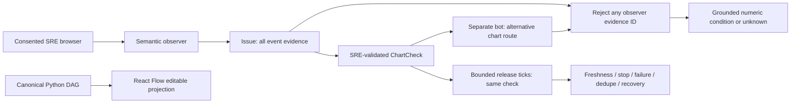

# Reject replay from the whole observed issue

The synthetic SRE assistant previously rejected only the final, validated check's
source evidence ID. A bot could return an earlier event's still-fresh ID from the
same observed issue and receive a healthy/failure conclusion. It now rejects IDs
from **every** issue event, returning `unknown` with the existing replay reason.
This is evidence-reference checking, not proof against a dishonest adapter that
invents a new ID. No image/content hashing, execution framework or schema added.



## Walkthrough
- `triage/chart_checks.py`: extend existing independent-investigation replay guard
  over the immutable issue timeline. Zero net production lines; bounded observer
  contract remains 100 events. No public interface or release behavior change.
- `tests/test_chart_checks.py`: different earlier/final evidence IDs, healthy and
  failing replay rejection, original observer result retained, and genuinely new
  bot evidence allowed. Existing final-ID rejection retained.
- `tests/test_chart_browser.py`: actual loopback HTTP + Selenium waits/fake DOM;
  separate observer/bot drivers, two-page observed journey, earlier-ID replay,
  recovery with new evidence and reuse in bounded release failure/dedupe/recovery/end.
  This is **not** a rendered browser/model run.

## Commands
From the repository root, with its existing Selenium test environment:

```sh
python -m unittest discover -s tests -v
python evaluate.py
python -m examples.chart_release
python -m compileall -q triage tests
cd ui
npm ci --include=dev --no-audit --no-fund
npm test
npm run build
```

Before the fix, the two new methods reproduced four failing subcases (healthy and
failure replay in the unit and HTTP/DOM paths). Exact final counts/logs are in the
PR and dated development report. Real browser/model/video acceptance is separate;
no production recording, live monitoring, deployment or main release performed.
