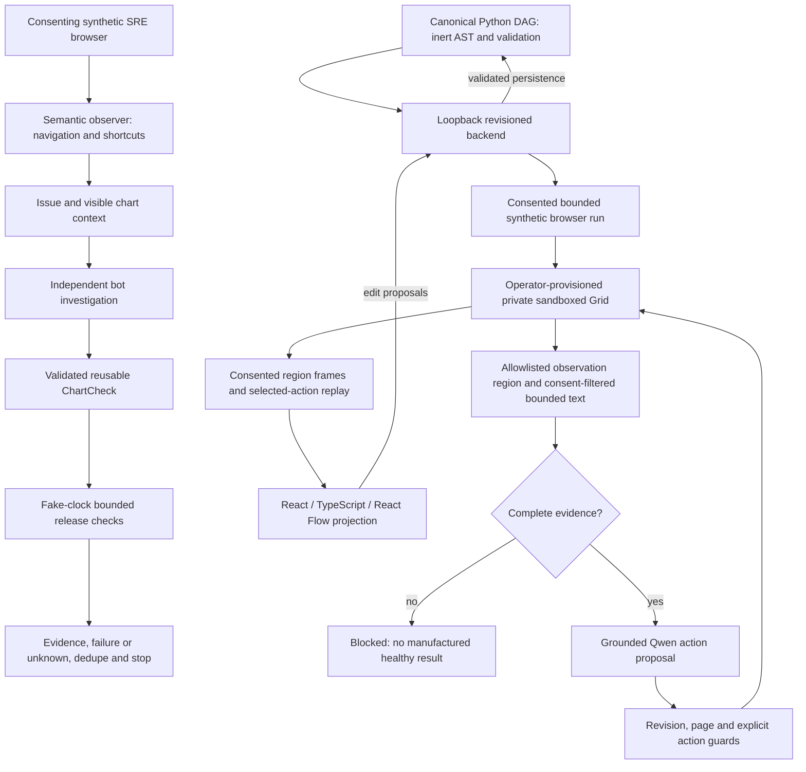

# Reject character-truncated browser evidence

## Defect and smallest fix

The shared consent-filtered DOM walker stopped at `>= max` characters without flagging incomplete evidence. A result with `Errors: 0`, enough whitespace to reach the limit, then `failures still loading` in another text node became the exact healthy assertion. A truncated control label could similarly omit a forbidden action word. Node-budget exhaustion was already rejected; character-budget exhaustion was not.

The same existing `incomplete` flag now covers raw character overflow. Traversal continues at the exact boundary to discover a later qualifier; it only stops and marks incomplete on overflow. Backend `observe()` already rejects that flag before proposal/capture and during pre/post-action verification. Its error now names the general text budget. No new dependency, parser, execution path or permission. Net production line change: zero.

Conservative limit: raw whitespace and separators count toward the budget before normalization; oversized but semantically short text is blocked rather than guessed. A denied/unknown outcome is intentional. An exact-boundary final text node remains accepted. Private text remains excluded, existing text-node budgets retained, returned strings remain capped.

## Actual architecture and boundaries



Grid and Qwen nodes describe implemented integration boundaries, not successful new live runs. The deterministic UC1/UC2 suites remain separate from the Studio browser-run acceptance gate.

## File walkthrough

- `triage/browser_loop.py`: shared text walker flags character overflow; existing Python guard reports generic text-budget exhaustion. Initial, pre-click and post-click observations share the guard.
- `ui/src/browser-observation.test.js`: execute the actual embedded script in Node VM against a DOM double. Six regression cases cover result/label/page, one oversized node and a separate later qualifier, plus exact-boundary acceptance in every case.
- This document: reproduction, architecture, checks and limitations.

## Executed evidence

Before fix: **6 failing / 147 passing frontend tests**, covering both overflow shapes in all three text scopes. After fix: **153 frontend tests PASS**, TypeScript and Vite build PASS (existing bundle-size advisory). Full Python regression: **145 PASS / 3 real-browser SKIP / 0 FAIL** (148 run). Evaluation: **60/60 diagnoses and 60/60 healthy counterexamples**. Connected synthetic UC1 (navigation + shortcut → issue → independent chart investigation) and UC2 (same validated check → fake-clock 300-second bounded release, failure/unknown/dedupe/end) PASS. Existing Python regression verifies incomplete evidence rejection before initial capture, before click and after click, with cleanup and performed/unverified state retained.

Commands from repository root:

```sh
(cd ui && npm ci --include=dev --no-audit --no-fund && npm test && npm run build)
python -m unittest discover -s tests -v
python evaluate.py
python -m examples.chart_release
git diff --check
```

This is actual script execution with simulated DOM, not physical browser evidence. Existing lifecycle tests use simulated WebDriver; optional ffmpeg test encodes simulated frames. No new actual model inference, Grid/browser session, captured live video, rendered UI acceptance, production monitor or deployment. Exact-head GitHub CI must succeed before SHA-guarded merge to `blue-master`; `main` remains human-controlled.
