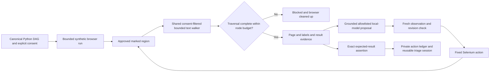

# Incomplete DOM evidence must fail closed

A marked result containing `Errors: 0`, thousands of ignored/private text nodes, then a visible loading/failure qualifier could exhaust the text-walker budget. The old walker silently returned the plausible prefix. Exact-result verification could therefore report a false pass without reading the qualifier. Labels and page evidence had the same silent partial-read problem.

The existing shared walker now marks traversal exhaustion. The Python observer rejects that observation before hashing it, sending it to a model, recording a frame or accepting an assertion. This applies to initial observation, pre-action freshness checks and post-action verification. A completed traversal of exactly the budget is accepted. Existing character limits (including the 501-character overlong-result sentinel) are unchanged. No retry loop, dependency or new permission.

## File walkthrough

- `triage/browser_loop.py`: one shared exhaustion flag, returned after all text reads and checked at the Python boundary; **two net added production lines**, no framework or dependency.
- `ui/src/browser-observation.test.js`: executes the exact embedded JavaScript in Node VM against a DOM test double; label/page/result overflow and exact-budget boundary regressions.
- `tests/test_browser_loop.py`: simulated WebDriver run tests initial/pre-click/post-click exhaustion, preventing false pass, pre-click side effects and post-click fabricated verification; cleanup checked in all phases.
- This guide: architecture, evidence and remaining acceptance gates.

## Actual local evidence (fresh blue-master ac78f1e)

- Before fix: four frontend assertions failed; one Python regression reported `passed` instead of `blocked`.
- `cd ui && npm ci --include=dev --no-audit --no-fund`: PASS.
- `cd ui && npm test`: **147 PASS**.
- `cd ui && npm run build`: TypeScript/Vite PASS; existing bundle-size advisory remains.
- `../demo/.venv/bin/python -m unittest discover -s tests -v`: **145 PASS, three actual-browser tests SKIPPED** (148 run).
- `../demo/.venv/bin/python evaluate.py`: **60/60 diagnoses and 60/60 healthy counterexamples**.
- `PYTHONPATH=. ../demo/.venv/bin/python examples/chart_release.py`: synthetic observer → issue → independent investigation plus reused bounded release check PASS.

These are executed script/unit/HTTP/simulated-driver tests, not rendered browser acceptance. No new inference, actual browser/Grid session or actual captured video was run. UC1/UC2 complete browser/model journeys, physical UI, capture/replay and handoff remain open. The existing private Grid deployment/access and sandbox-capable-node blocker is unchanged. The running 3031 backend/source is preserved, not upgraded or deployed. Main remains human-controlled; no production monitoring, private-session recording or security bypass. Parent scope/safety review only; no independent-review claim.
