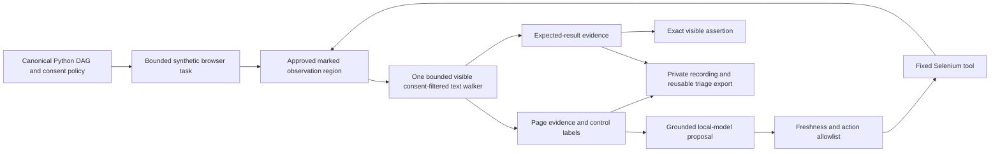

# Observation-result privacy regression

The marked result previously used `innerText`, bypassing the consent filter applied to page evidence and control labels. A private/form descendant inside an otherwise permitted result could therefore enter the model observation, evidence hash and saved action ledger. One bounded text walker now handles all three reads, excluding private/editable/form/hidden ancestors and normalizing visible whitespace. Existing limits remain 120 characters/500 nodes for labels, 8000/5000 for page text and 501/5000 for results (501 retains the overlong-result sentinel against the 500-character expected policy).

## Files

- `triage/browser_loop.py`: replaces separate label/page/result extraction with the existing bounded-walker pattern; no new runtime dependencies or permission changes. Net production change: **one line removed**.
- `ui/src/browser-observation.test.js`: runs the exact Python-embedded observation JavaScript in Node's VM with a small DOM test double; checks private, hidden, aria-hidden, editable and form descendants, whitespace normalization and result length. These are script unit tests, **not rendered browser evidence**.
- This guide: reproduction, evidence, architecture and limitations.

## Executed from fresh blue-master 07f4ff3

- Before fix: six new script tests failed; private/form text was reproduced in result evidence.
- `cd ui && npm ci --include=dev --no-audit --no-fund`: PASS, local dependencies installed.
- `cd ui && npm test`: **143 PASS**, including six new regressions.
- `cd ui && npm run build`: TypeScript and Vite PASS; existing large-chunk advisory remains.
- `../demo/.venv/bin/python -m unittest discover -s tests -v`: **144 PASS, three actual-browser tests SKIPPED** (147 run).
- `../demo/.venv/bin/python evaluate.py`: **60/60 diagnoses and 60/60 healthy counterexamples**.
- `PYTHONPATH=. ../demo/.venv/bin/python examples/chart_release.py`: connected synthetic SRE-assistance and bounded release-check journey PASS, not actual browser/model acceptance.

No real browser/Grid run, new model inference, private/live recording, deployment or production monitoring occurred. DOM rendering/capture masks and the complete UC1/UC2 browser/model journeys remain separate open gates. The running backend/source is preserved; this feature does not hot-upgrade it. Parent scope/privacy review performed; independent native reviewer is unavailable due the existing gateway-token mismatch. No main release or security-boundary changes.
