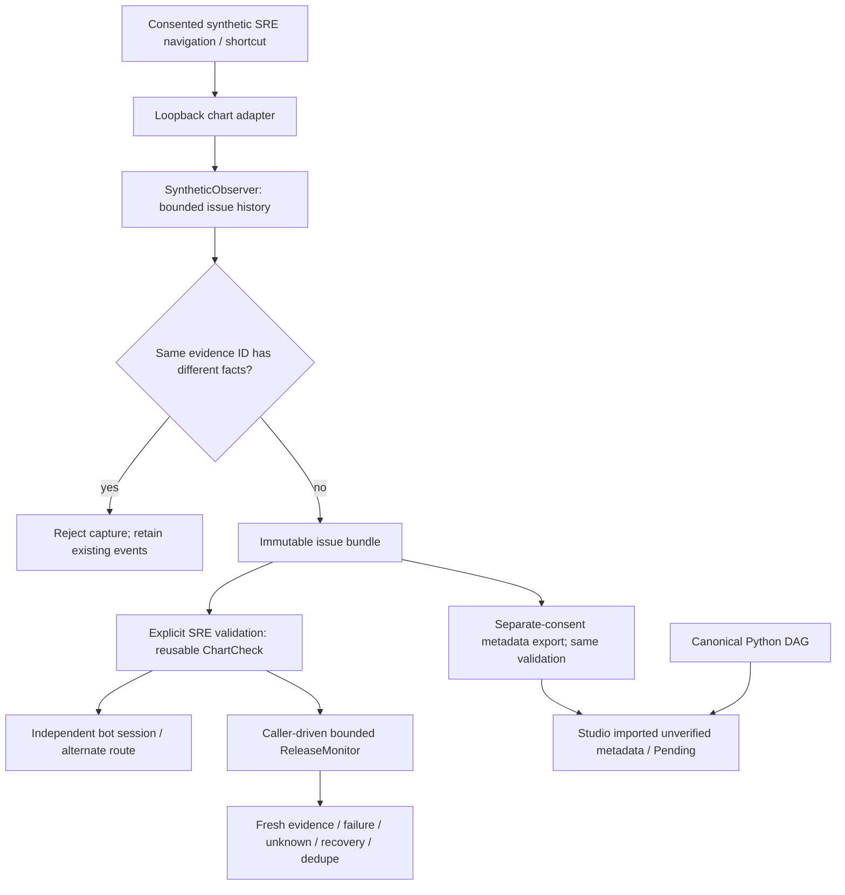

## Feature demonstration — keep one meaning per observed evidence reference

**User outcome:** an observed issue can no longer associate contradictory chart facts with the same evidence ID. A rejected capture leaves earlier evidence intact; a fresh ID lets the SRE continue, independently investigate and reuse the validated check during a bounded release.

**Fresh screenshot gate INCOMPLETE:** the affected `SyntheticObserver.record`/metadata-export validation boundary has no UI control or rendering surface. Actual API/CLI execution is provided below, not an invented UI. Related synthetic chart fixture was not freshly rendered; last verified local missing `libnspr4.so` and remote Grid-to-separate-loopback fixture blockers remain, without repeated probes or security changes. No historical images substituted. No new rendered-browser/model/video acceptance.

**Executed normal API path:** consented navigation captures value 0 → another chart with the same ID/value 8 is rejected with no appended event → identical facts under a repeated semantic action remain accepted → fresh-ID capture succeeds → explicit SRE validation → independent alternative-route failure conclusion → same check at fake-clock 300-second cadence exercises healthy, failure/dedupe, healthy recovery, loading unknown/recovery and bounded end. The separate executable demo asserts each outcome.

- [Immutable execution output](https://github.com/orionnelson/llm-bot-selenium/blob/blue-master/docs/OBSERVER_IDENTITY_DEMO.json): actual loopback HTTP + Selenium waits with fake DOM, **not** physical browser or inference.
- [QA and source/build metadata](https://github.com/orionnelson/llm-bot-selenium/blob/blue-master/docs/OBSERVER_IDENTITY_QA.md). Exact chart source SHA256 and remote baseline appear in the execution output.
- Pre-fix: five unit subcases and one actual HTTP/fake-DOM regression fail. Post-fix: **192 Python passed, 5 opt-in browser skipped; 179 frontend passed; TypeScript/Vite build passed; 60/60 diagnoses and 60/60 healthy counterexamples; connected synthetic UC1/UC2 example passed.**

## Summary

Two production lines reject an evidence ID reused with different immutable `ChartView` facts. Identical repeated observations remain valid. No new dependency, API, schema, executor, scheduler or transport. Shared observer validation also protects explicit Studio metadata export from forged ambiguous bundles.

## Architecture

1. Explicit consent and scope limit the person's synthetic observations.
2. Existing bounded history now refuses conflicting meanings for one reference.
3. SRE validation derives the same reusable condition and observer provenance.
4. Separate investigation and release ticks collect fresh guarded evidence.
5. Studio remains a Python-DAG projection; no live recording or schedule runs.

## File walkthrough

- `triage/chart_checks.py`: reject conflicting prior evidence before appending; reuse existing history capped at 100 events (no index/state duplication).
- `tests/test_chart_checks.py`: conflicting value/time/loading/session/UI facts rejected; history intact, identical repeat/new reference accepted.
- `tests/test_chart_browser.py`: actual HTTP/fake-DOM capture rejection and recovery through independent investigation and release failure/recovery/end.
- `tests/test_studio_session.py`: new timestamps receive distinct fixture IDs; forged ambiguous export rejected by the same shared guard.
- `ui/src/observer-session.test.js`: cross-language exporter fixture now uses a fresh reference for its new capture time; native graph/Python roundtrip and Pending semantics preserved.
- `docs/OBSERVER_IDENTITY_QA.md`, `docs/OBSERVER_IDENTITY_DEMO.json`: executed evidence, exact source hash, commands and limits.

## Tests and review

Executed from the isolated latest-remote source: `../demo/.venv/bin/python -m unittest discover -s tests -v`, `python evaluate.py`, `python -m examples.chart_release`, `python -m compileall -q triage tests examples`; UI `npm ci --include=dev --no-audit --no-fund`, `npm test`, `npm run build`; whitespace check. Existing Vite large-chunk advisories retained. Earlier full runs exposed four Python/three frontend fixture failures because they assigned changed timestamps the same ID; corrected fixtures now reflect immutable evidence rather than weakening the guard.

Parent scope/DRY review only: native reviewer/delegation launch actually blocked by gateway-token mismatch. No independent review claimed. No major UI change/review issue required.

## Compatibility and limitations

A reference is immutable within one bounded issue. Existing producers must assign a new ID when any `ChartView` fact changes, including capture time; repeated unchanged facts remain compatible. Older ambiguous imported metadata bundles now fail validation instead of being silently exported. This does not prove an adapter truthful, enforce IDs across unrelated issues, or make DOM collection atomic. No real/private recording, production monitor/deployment, shared model changes or main release. Full UC1/UC2 and expanded Studio/browser/model/video/full-graph/parallel/handoff gates remain open; development stays enabled. Exact-head green CI is required before merge to `blue-master` only.
