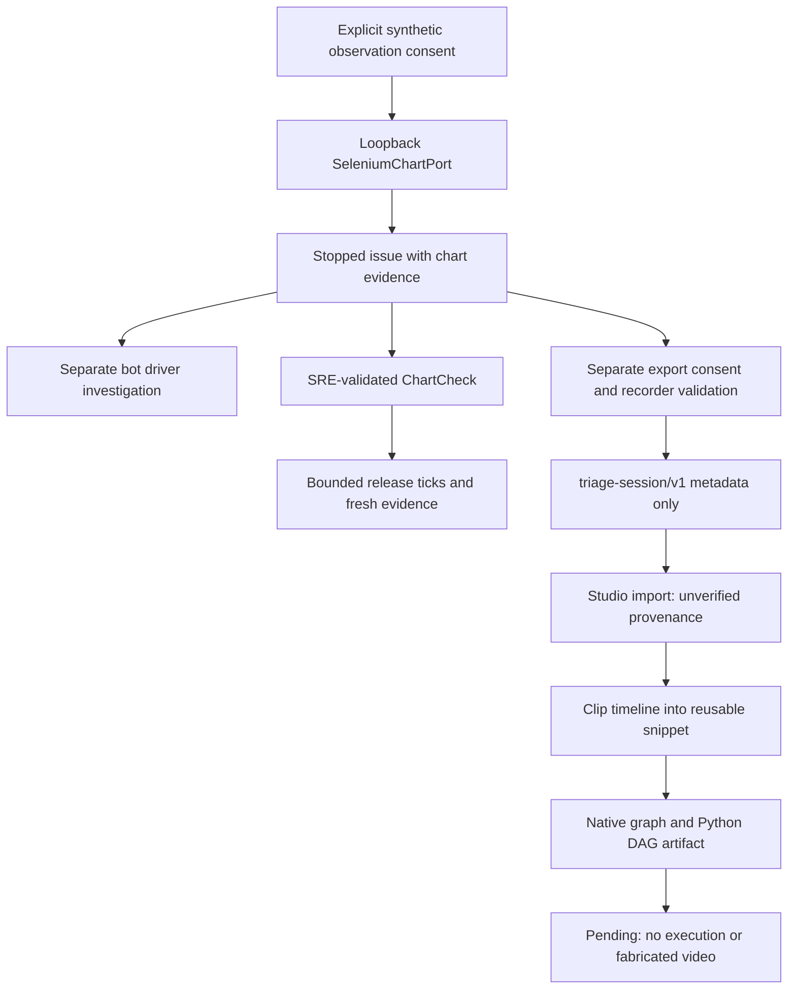

# Consented loopback observer → reusable Studio snippet

The existing `SeleniumChartPort` now exports an existing stopped issue's semantic
navigation/shortcut metadata in the editor's `triage-session/v1` format. This is
**not a video recorder, automatic shortcut listener, evidence archive or executor**.
The adapter is still loopback-only. Full chart context/value/evidence remains in
the original issue, available to the existing independent investigation and
SRE-validated release check; this export deliberately does not duplicate it.

## Usage

After the existing explicit-consent loopback `capture(...)` calls:

```python
import json
from pathlib import Path

issue = observer.stop()
# Separate, explicit consent to export metadata. sre is the original adapter.
session = sre.export_studio_session(issue, consent=True)
with Path('triage-session.json').open('x', encoding='utf-8') as output:
    json.dump(session, output, indent=2)
```

In **Triage → Import triage session JSON**, select the inclusive event range, save
a snippet, and add it to the canvas. `shortcut-open-chart` stays a semantic action,
not raw keys or an inferred click. Import is explicitly **imported/unverified**;
the selected-node inspector lists its ordered actions. Workflow JSON and native
Python DAG exports preserve the snippet. Running the node remains **Pending**.
There is no recording/video supplied, so no video playback is claimed.

## Architecture



## Guardrails

- Requires literal `consent=True`, the original WebDriver identity, 1–100 events,
  ordered integer timestamps, a maximum 24-hour exported duration and existing
  recorder action/route/view validation. Export does not touch the DOM or navigate.
- Generates an opaque export ID: **no WebDriver session ID**, chart binding query,
  evidence ID/value, cookies, keys, page text, password or credential enters output.
- Only the configured loopback origin plus allowlisted `/chart/` route is emitted.
  Chart URL query context is deliberately omitted. Repeated exports get new IDs;
  IDs are provenance labels, not authentication or cross-export deduplication.
- Loading/expired observations can remain metadata, but nothing is classified as
  healthy or executed. They must pass the existing fresh-evidence checks before
  investigation/release use. A snippet is not an SRE-validated `ChartCheck`.
- No dependency, schema version migration, background monitor, provider call,
  listener, live transport, real-site recording or production deployment added.

## File walkthrough

- `triage/chart_browser.py`: consented metadata-only export; reuses recorder checks.
- `ui/src/snippets.ts`: additive semantic shortcut allowlist, same privacy validator.
- `tests/test_studio_session.py`: consent/identity/budget/ordering/privacy/unknown tests.
- `tests/test_chart_browser.py`: real loopback HTTP + fake-DOM capture/export paired
  with existing independent investigation and bounded release checks.
- `ui/src/observer-session.test.js`: actual Python subprocess → TypeScript import →
  clipping → native graph → actual Python AST/DAG roundtrip; execution stays Pending.

## Executed evidence (2026-10-20)

- Pre-implementation: 4 new Python test methods failed (12 missing-method errors).
- `python -m unittest discover -s tests -v`: 103 run, **101 passed / 2 actual-browser
  skipped / 0 failed**. The HTTP driver is a fake DOM, not rendered Selenium.
- `cd ui && npm ci --include=dev --no-audit --no-fund && npm test`: **128 passed**.
- `cd ui && npm run build`: TypeScript + Vite passed. Existing main/optional ELK
  chunk-size advisory remains, not hidden or solved by this change.
- `python evaluate.py`: **60/60** deterministic cold/reuse diagnosis pairs and
  **60/60** healthy counterexamples. No model inference benchmark.
- `python -m examples.chart_release`: existing connected synthetic UC1/UC2 passed,
  including dedupe, unknown/loading, recovery and bounded end.
- Compilation and git whitespace checks passed.

Parent performed scope/privacy/DRY review. Independent native reviewer could not
start: gateway token mismatch. No successful independent review claimed.

**Open gates:** real Edge/Chrome journey, actual approved model-led investigation,
consented capture transport/real video and selected-action seek, execution planner,
visual usability acceptance and handoff. No browser launch or video/model acceptance
is asserted by these tests. Keep development enabled; `main` remains human-controlled.
