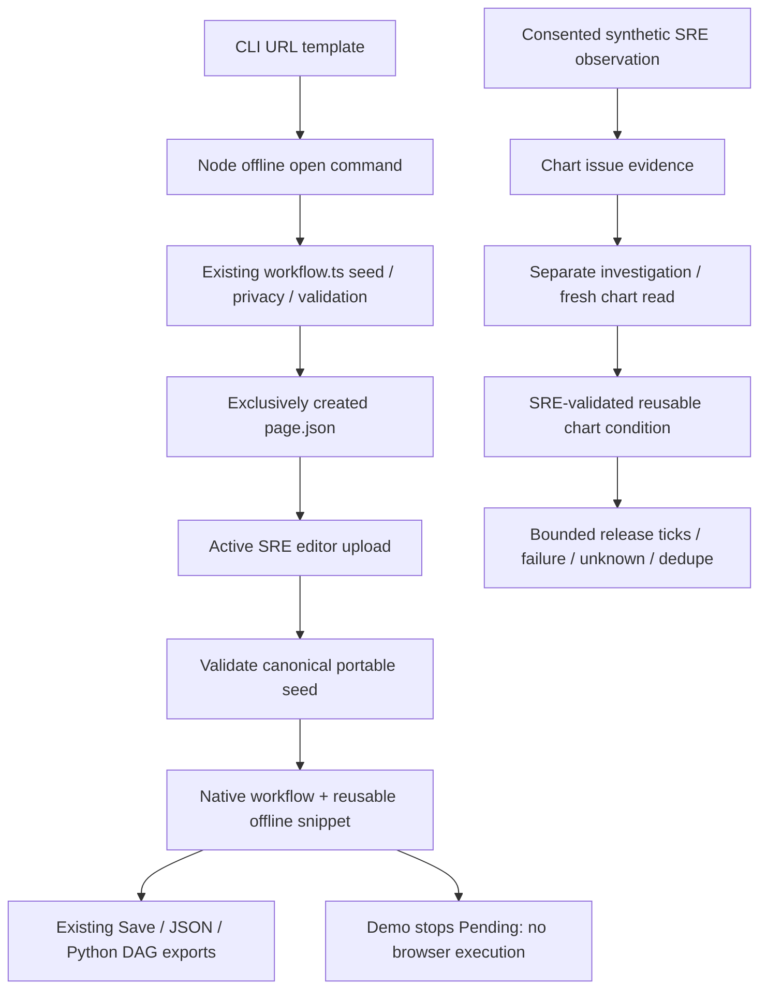

# Offline CLI page seeds — 2026-10-20

## Try it

Use Node **22.18+**. From `ui/` after `npm ci`:

```sh
npm run seed -- open 'https://example.com/services/{service}?query={xyz}&region=discard-me' --output page.json
```

In the active SRE editor, use **Run History → Import workflow JSON** (upload icon) and choose `page.json`. This replaces the current draft, just like the existing workflow import; save your draft first. The editor creates Start → offline Browser Snippet → End and adds the snippet to its reusable library. Save/export use the existing native version1 workflow; DAG export retains the same snippet parameters/provenance.

- `{service}` / `{xyz}` remain named path/query placeholders; a literal `region` query becomes `{region}` with an empty binding.
- Literal query values are discarded, sensitive keys are redacted, and every saved parameter value starts empty. No page is fetched and no model is called.
- This is **offline-template** provenance with zero observed steps/event IDs. The familiar “Enter” prompt is an unverified template intent, not page detection or model output.
- Demo execution stops at the snippet as **Pending / waiting**, with End skipped. It never reports the browser page as successfully visited.
- Existing output files (including symlinks) are not overwritten. New files request mode0600. Errors do not echo URLs, arguments or paths. Use synthetic URLs: shell history/process listings can still expose command-line input.
- Only canonical unmodified seeds are converted. Edited older `workflow-studio/v1` graphs are rejected instead of silently losing their actions. This is not a general legacy-graph migration.

## Actual implementation



The CLI imports the actual TypeScript guard using Node type stripping, with explicit `.ts` shared-contract imports. No second Python graph parser, new runtime dependency, browser launch, scheduler or deployed service is introduced. Native snippet validation now distinguishes offline/no-events from recorded-or-live/nonempty-events. Existing SRE assistance and bounded release monitoring code is unchanged.

## Executed evidence

- `cd ui && npm ci --include=dev --no-audit --no-fund`: PASS.
- `cd ui && npm test`: **125 passed**, including 19 new subprocess/import/provenance/no-clobber tests. Tests actually execute the CLI, parse its output through the editor validator, import the active native graph, replay to Pending, roundtrip JSON/DAG metadata, reject unsafe URLs and edited legacy graphs, and exercise unreachable `.invalid` input without navigation.
- Existing cross-language test now also loads the offline-seeded native DAG through actual Python AST/dataclasses/graphlib and checks exact spec roundtrip.
- `cd ui && npm run build`: TypeScript + Vite PASS; existing >500kB bundle advisory remains.
- `python -m unittest discover -s tests -v`: **99 run, 97 passed, 2 actual-browser skipped**.
- `python evaluate.py`: **60/60 deterministic cold/reuse pairs; 60/60 healthy counterexamples**.
- `python -m examples.chart_release`: executed connected synthetic UC1/UC2 example PASS.
- `python -m compileall -q triage tests examples` and `git diff --check`: PASS.

The initial missing-command test run failed as expected. A first implementation run exposed an incorrect test assumption (sensitive queries are intentionally redacted when seeding, not rejected); it was corrected to match the existing guard. No production-code privacy rule was weakened.

## Still not acceptance

No actual browser upload/pointer/visual test, Selenium/video capture, actual model-led page understanding or real release check was run. Existing browser tests skip because approved runnable binaries/sandbox are not available. UC1/UC2 browser+model and expanded Studio/handoff gates remain open. Native independent reviewer could not start (gateway token mismatch); parent source/diff review performed. No production deployment, real-person recording, sandbox bypass or main release.
