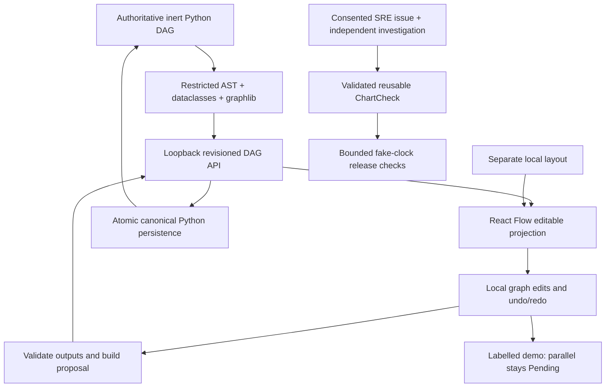

# Backend-owned parallel authoring and safe rewiring

This slice integrates the owner's previously LAN-only authoring changes onto fresh `blue-master` (39878baec322713751c42ff71b6a17ed2d28fba3), without copying the old UI-first snapshot over newer backend/browser/privacy code.

## Architecture

## Behavior and boundaries

- Python accepts named parallel routes `branch:<destination>`; dependencies still match incoming routes, and graphlib still rejects cycles. Previously saved single-output parallel tasks using `next` remain readable. Mixing that legacy port with fanout is rejected.
- Canvas import/export preserves every branch and join dependency. Serial controls remain one destination per output; IF/ELSE and loop ports are validated independently.
- Replacing a connection may temporarily create two edges in an editable draft. Save, functional export and demo execution reject ambiguous serial outputs until the unwanted edge is removed. Save checks before writing local storage or issuing a backend request. Ordinary duplicate/cycle/direction guards remain.
- Parallel graphs are authorable, backend-validatable and persistable; **this is not a concurrent execution adapter**. The demo stops Pending rather than choosing a branch or claiming execution.
- Layout remains separate; proposals still require backend revision checks and canonical persistence. No handlers/generated Python are executed. No new schema, dependency, scheduler, hosting deployment or permission.
- UC1/UC2 browser/chart/release logic is preserved, including consent, independent sessions, bounded cadence, replay prevention, unknown states and stop behavior.

## Executed evidence (2026-10-23)

- Before changes: four frontend regressions failed (152 passed); new Python backend fanout test failed with `Invalid route/port`.
- `demo/.venv/bin/python -m unittest discover -s tests -v` from source: **146 passed, 3 actual-browser tests skipped** (149 total).
- `npm test -- --maxWorkers=2`: **157 passed**, including actual Python-authored DAG -> HTTP -> TypeScript projection -> revisioned commit -> persisted Python and branch/join preservation. Cross-language AST/graphlib tests retain CLI page-seed and loop coverage.
- `npm run build`: TypeScript and Vite PASS; existing bundle-size advisory remains.
- `demo/.venv/bin/python evaluate.py`: 60/60 diagnoses and 60/60 healthy counterexamples. `python -m examples.chart_release`: actual connected deterministic UC1/UC2 fixture example PASS; no sleeps/live schedule.
- Compilation PASS. Tests use real loopback HTTP/subprocesses and simulated browser/DOM data where applicable; they are not rendered-browser or real-model acceptance.

Actual Grid/sandbox-capable runtime, physical UI gestures, real recording/replay, full model-led UC1/UC2 and concurrent execution/handoff remain open. No model invocation or browser recording was performed by this slice. Existing private Grid/operator-access blocker remains; no security bypass. No LAN/production deployment. Keep development enabled.
