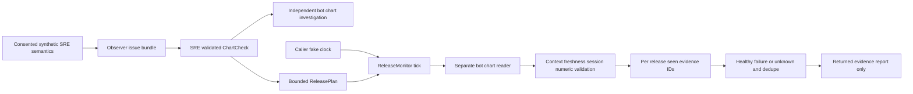

# Release evidence replay regression — 2026-10-19

## Defect and fix
The release monitor only remembered its most recent evidence ID. With a supported short cadence, still-fresh evidence A → B → A could incorrectly become healthy; the original SRE observation could also return after an intervening read. Now each bounded release remembers all encountered evidence IDs, including the source observation and invalid/loading reads. Reuse returns unknown, never healthy. A genuinely new ID still goes through the existing context, freshness, numeric, session and drift checks. This does not prove that a malicious source minted a new ID for old data.

The set is instance-local, not a global registry. The existing maximum 24-hour window, minimum one-second cadence, monotonic integer ticks and missed-slot skipping permit at most 86,400 reads; semantic IDs are validated before storage. No durable store, worker, alert transport or live schedule is added. Net production change: +2 lines.

## File walkthrough
- `triage/chart_checks.py`: replace last-ID comparison with bounded release-lifetime replay detection; validate IDs before storing.
- `tests/test_chart_checks.py`: nonconsecutive A/B/A replay, return of original SRE evidence, and reuse of a previously loading ID after healthy recovery.
- This document: architecture, reproduction, executed evidence and limitations.

## Executed evidence
In `projects/observability_browser_agent/replay-slice`, using `../demo/.venv/bin/python`:
- Before fix, `-m unittest discover -s tests -p test_chart_checks.py -v`: 15 tests, **3 assertion failures** across the two added tests. All three incorrectly returned healthy for reused evidence.
- After fix, `-m unittest discover -s tests -v`: **82 total, 80 passed, 2 real-browser skipped, 0 failed**.
- `evaluate.py`: 60/60 deterministic diagnosis matches and 60/60 healthy counterexamples; 15 held-out skill validations. Not actual model inference.
- `-m examples.chart_release`: executed synthetic UC1 alternative-path investigation and UC2 release example successfully.
- `-m compileall -q triage tests examples` and `git diff --check`: passed.
- A direct `python examples/chart_release.py` attempt lacked the package import path; reran successfully with the module command above. Do not count the failed invocation as acceptance.

Detailed parent-run logs: `replay-before-tests.txt`, `replay-tests.txt`, `replay-evaluation.json`, `replay-journey.json` in the workspace project directory.

## Acceptance and ownership
UC1 synthetic regressions preserved, UC2 replay defect reproduced/fixed. Real Edge/Chrome, actual model-led investigation, actual recording/replay and production acceptance remain unproven. No live monitor, recording, model-service change or deployment.

Workflow Studio was intentionally not overwritten: OpenCode session `ses_eae4792e1ffezmRxoB8vrlxgO1` completed and was idle, while the local Studio had newer App/SeedStudio/store/style edits (through 02:00 UTC). It is a separate active authoring surface; this run used fresh remote `blue-master` in an isolated directory rather than syncing over it. Studio install/build/UI claims belong to its owner, not this regression PR.
