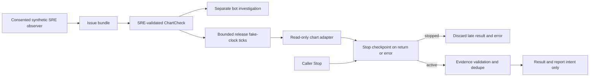

# Release stop during an in-flight read

The caller-driven `ReleaseMonitor` reuses the SRE-validated `ChartCheck` from the observer/independent-investigation journey. Stop is terminal: a read already in progress must not publish a late healthy/failure/unknown result, alter report dedupe state, or retain its evidence identifier.

## Change

Check the existing stop flag immediately after the adapter returns, and on its exception path. No scheduler, dependency, cancellation framework or live monitor was added (+4 production lines). Normal session expiry without an explicit caller stop still produces its unknown result and then stops. Cadence, release bounds, replay rejection and separate-session rules are unchanged.

## File walkthrough

- `triage/chart_checks.py`: two stop checkpoints around the existing synchronous adapter call.
- `tests/test_chart_checks.py`: four deterministic in-read stop cases (healthy/failure/expired/error), plus an actual background-thread test with Event-coordinated stop and read completion/error. No sleeps or network/browser calls in these new tests.
- This guide: scope, evidence and remaining limits.

## Executed 2026-10-23 14:00 UTC

From the repository root (local project `../demo/.venv/bin/python`):

- `python -m unittest discover -s tests -v`: **151 total, 148 passed, 3 actual-browser acceptance tests skipped**.
- Before the fix: four subcase failures reproduced the late result/report defect.
- `python evaluate.py`: **60/60 diagnosis matches and 60/60 healthy counterexamples**.
- `PYTHONPATH=. python examples/chart_release.py`: connected synthetic observer, alternative bot navigation and bounded 300-second release sequence passed.
- `python -m compileall -q triage tests` and `git diff --check`: passed.
- `cd ui && npm ci --include=dev --no-audit --no-fund && npm test && npm run build`: **162 frontend tests passed**, TypeScript/Vite build passed (existing large-bundle advisory).

Parent source review only; independent native reviewer could not connect because of the existing gateway-token mismatch. Initial test invocation used the wrong Python environment and skipped Selenium contracts; final results above use the established project venv and execute them. The example needs `PYTHONPATH=.`; corrected command above was actually executed.

## Limits

This is cooperative result suppression at the adapter boundary, not preemptive cancellation of an underlying Selenium/network operation or thread-safe multi-caller tick execution. The caller still owns read timeouts and must serialize ticks. No alert transport exists here. Event waits in tests are bounded synchronization, not product scheduling or fake-clock sleeps.

UC1 synthetic journey and UC2 release reuse regressions pass; full browser/model acceptance remains open. No new model inference, real browser, private session recording, real video, physical UI interaction or production deployment was run. Grid deployment/access and a sandbox-capable runtime remain operator blockers. Existing preview/backend were not changed; main release remains human-controlled.
