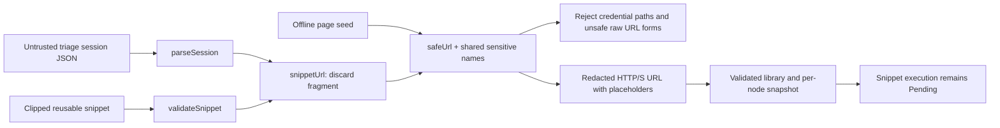

# Workflow Studio: safe reusable triage URLs (2026-10-19 14:00 UTC)

## Concrete fix

The triage snippet importer had a second, weaker URL parser than page seeds. Reproduced seven failing regressions: `sid`/`jwt` query values survived session import and saved snippets, and five raw unsafe URL forms were accepted (literal/encoded credential paths, backslashes, shorthand scheme, whitespace).

`snippetUrl` now delegates to the existing `safeUrl` validator before normalization, retaining the triage contract that fragments are dropped. Page seeds and triage snippets share the sensitive-name rule, now also including signed query values (`signature`). Normal service queries and `{service}` placeholders still work. This is conservative filtering, not comprehensive secret detection: innocuously named query values and arbitrary private page paths require the approved data boundary. No existing localStorage migration or remote deletion is performed.

## Architecture

## File walkthrough

- `ui/src/workflow.ts`: shared URL validation and sensitive-name rule, extended for signature queries.
- `ui/src/snippets.ts`: removes duplicate parser; routes session URLs, event URLs and saved snippet templates through the existing guard.
- `ui/src/control-snippets-layout.test.ts`: eight new table-driven cases plus a raw-length compatibility assertion across session import, event clipping and library/per-node persistence; existing token assertion checks the semantic query value instead of one encoding spelling.
- `ui/src/workflow.test.ts`: page-seed signed-query redaction and rejection of sensitive placeholder names.
- `.github/workflows/tests.yml`: adds `studio-tests` (Node22, Python3.11, lockfile install including dev dependencies, unit tests and production build). Python `synthetic-tests` is retained. No production execution or deployment.

## Executed evidence

Fresh source fetched from remote `blue-master` at `1c6e95fc82a5f72ce5fea9655f18261731a15898`; not an old local Studio snapshot. Existing OpenCode author status was idle (`{}`), and its saved implementation response was completed. No new authoring session or overwrite of the held PR11 workspace.

- Before fix: **7 failing / 97 passing** frontend tests (104 total); signed-query seed test added afterward.
- After fix: `cd ui && npm test`: **106 passed, 0 failed**.
- `cd ui && npm run build`: TypeScript and Vite PASS. Existing bundle-size advisories remain (main ~527KB, optional ELK ~1.44MB).
- `../demo/.venv/bin/python -m unittest discover -s tests -v`: **99 run, 97 passed, 2 actual-browser skipped**.
- `../demo/.venv/bin/python evaluate.py`: **60/60** deterministic diagnosis pairs and **60/60** healthy counterexamples.
- `PYTHONPATH=. ../demo/.venv/bin/python examples/chart_release.py`: actual synthetic UC1 alternative-route failure conclusion; UC2 healthy/failure/duplicate/unknown/recovery/end sequence PASS.
- Python compile and git whitespace checks PASS.

Initial `npm ci` omitted dev dependencies under the production environment; corrected with `--include=dev`. Initial direct example invocation lacked PYTHONPATH; corrected command above executed successfully. Neither initial invocation is counted as an acceptance success.

## Acceptance boundaries

- UC1: synthetic semantic observation, independent navigation and evidence checks regressions retained; no actual consenting browser listener or model-led page understanding validated.
- UC2: same check representation and bounded fake-clock release tests retained, including release-lifetime replay rejection. No live five-minute monitor, alert send or deployment.
- Studio: real unit/build, cross-language Python DAG and SSR evidence only. No physical pointer, genuine video replay, real recording, live model inference or screenshot acceptance in this run.
- PR11 owner review hold remains untouched. This independent change targets current `blue-master`; main remains human-controlled. CI/PR/merge receipts are recorded separately rather than inferred from local results.
