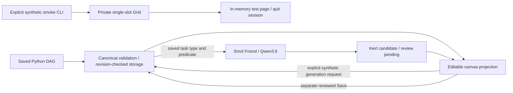

# Test-state function generation and Selenium Grid

The **Python DAG remains authoritative**. These opt-in test integrations do not execute generated functions or enable a production DAG/browser runner. The separate consented test-action adapter is described in BROWSER_LOOP.md.

## Start the test backend

Build `ui/` as in [the DAG guide](PYTHON_DAG.md). Initialize `runtime/workflow_dag.py` from `examples/editor_dag.py` only if no canonical file exists. From the repository root:

```sh
SELENIUM_GRID_URL=http://selenium-grid.llms.svc.cluster.local:4444 \
  python -m triage.dag_server --dag runtime/workflow_dag.py --port 3031 --test-mode
```

Open `http://127.0.0.1:3031/`. This is a **local test backend**, not the existing OpenCode/Bun static app on3001. Without `--test-mode`, generation and test-status endpoints return503. The service remains loopback-only and is not a public/authenticated multi-user deployment. It must be started in an environment with Python3.11+; the current OpenCode container has no Python runtime. A manually started process is not restart-persistent.

`GET /api/test/status` reports the selected model, actual configured Grid reachability/readiness, and `execution: consented-test-browser-actions` with `generatedPythonExecution: false`. A running static UI or a Grid process is not evidence of a working browser session.

## Smol Friend / Qwen3.6

The chosen available model is **`Qwen3.6-35B-A3B-UD-Q4_K_M-no-think`**, not the older Qwen3-Coder30B model. Server-side `SMOL_FRIEND_BASE_URL` optionally changes the trusted Smol Friend base; the default is `http://coder-30b-q4km-svc.llms.svc.cluster.local:8000`. No OpenAI/assistant fallback or credential copying is configured: a failed local model request fails explicitly.

1. Load/Save the canonical DAG, select an existing task, open its Python inspector, and enter **synthetic instructions without secrets**.
2. Generate. The backend resolves the task from the saved Python DAG, ignoring browser-supplied configuration/source. It sends only task action, numeric predicate and explicit instructions—not saved params, snippet URLs, implementation text, tokens, or browser sessions.
3. The local operating rule unloads resident models and explicitly loads Qwen before each request, waiting for actual unloaded/loaded states (the gateway acknowledges unload before the old process has stopped). **This swaps the shared model gateway's resident model.** One generation is allowed at a time; another returns429. DAG reads/saves remain responsive while inference is running.
4. Syntax/`run(inputs, context=None)` contract checks reject incomplete, fenced or mismatched-model candidates. Source is returned as inert text with model provenance, `review: pending` and `executed: false`. This is **not a safety sandbox**; syntactically valid source may still be dangerous. Review before saving. Marking it reviewed never authorizes execution.
5. The candidate enters the local draft; only a separate successful DAG Save persists it. Switching nodes aborts the browser request; server inference can finish within its bounded timeout but never applies a candidate automatically.

API: `POST /api/python/generate` accepts bounded JSON with `nodeId` and `instructions`. Unsaved tasks return409. Host/origin checks apply; provider paths/model are not request-controlled. No real-site recording, model-supplied selectors, deployment or mutation is enabled.

## One Selenium Grid instance

The Grid path now requests Edge, including the existing DAG-owned browser action adapter. See [EDGE_GRID.md](EDGE_GRID.md) for explicit real Grid tests and the read-only or9.ca example.

The smallest Grid is the official **standalone Edge Grid4** image: one server, one isolated browser slot. The pinned current release `4.51.0-20261010` was verified against the official release API; client `selenium==4.51.0` is already in the project lockfile.

An operator with cluster access can apply:

```sh
kubectl apply -k deploy/
```

This declares one non-root Deployment, private ClusterIP Service and synthetic-only NetworkPolicy in `llms`. No service account token, host mounts, personal profiles, privileged mode, public NodePort or browser egress. `/dev/shm` is memory-backed. Readiness probe means the Grid HTTP process is reachable, **not** a passed browser test. Keep these restrictions; do not loosen browser sandbox/security merely to pass acceptance.

The upstream browser shell wrapper adds `--no-sandbox`. The node configuration and `triage.grid.create_driver()` explicitly select the **native** `/opt/microsoft/msedge/msedge` binary instead. No sandbox-disabling flags are added. Hosts that cannot support Edge's sandbox must fail closed. The smoke check inspects actual browser startup arguments before navigation and refuses sandbox-disabled sessions.

With Grid deployed and the existing project venv installed:

```sh
SELENIUM_GRID_URL=http://selenium-grid.llms.svc.cluster.local:4444 python -m triage.grid
SELENIUM_GRID_URL=http://selenium-grid.llms.svc.cluster.local:4444 python -m triage.grid --smoke
```

The explicit smoke check starts one fresh Remote WebDriver, opens an **in-memory synthetic data URL only**, verifies its title, and quits in `finally`, including failures. No real-site or original SRE browser access. Unreachable/not-ready/unsafe Grid exits2, never success. Existing Edge/Chrome local launch paths and loopback consent/origin guards are unchanged. Connecting the full observed-journey/release checks to a remote fixture is still a separate acceptance gate, not implied by this isolated Grid check.



## Historical evidence and deployment blockers

For the current Edge Grid integration and live results, see [EDGE_GRID.md](EDGE_GRID.md). The observations below describe the earlier deployment checkpoint, not current reachability.

A live Smol Friend request returned a contract-valid Qwen3.6 function candidate with `executed: false`; the canonical DAG hash stayed unchanged. Actual HTTP tests also cover disabled mode, canonical-task lookup, provider failures, busy generation and responsive DAG access. Constructor/cleanup tests use mocks and are **not** live Grid evidence.

The new local backend was started for testing on127.0.0.1:3031. **The existing LAN app is unchanged.** Grid DNS did not resolve; Kubernetes API10.96.0.1:443 timed out; Docker, kubectl and Java are unavailable here. The Original manifest parsed as YAML; at that earlier checkpoint it had not been deployed. The actual Grid probe exited2; no browser/Grid success, screenshots, production execution or restart persistence is claimed. Cluster deployment and a sandbox-capable node remain operator blockers.


The connected browser action/recording adapter is documented in [BROWSER_LOOP.md](BROWSER_LOOP.md). Deploy with Kustomize to include the private synthetic fixture; browser egress remains denied.
