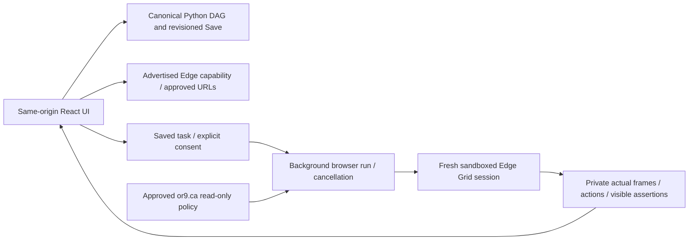

# UI ↔ Python backend ↔ Edge Grid

This replaces disconnected UI browser fixtures with the existing canonical backend/browser runner. It is not an assertion that every original SRE product requirement or every template integration is complete.



## One working UI/API origin

The Python server must serve **both** the built frontend and `/api/` endpoints. The legacy OpenCode/Bun host on port3001/NodePort32085 is a static template host, not this Python execution backend. Merely copying new assets there does not connect Grid. No unauthenticated LAN proxy to private recording/browser APIs has been added.

From the project root, using its existing Python venv and installed locked dependencies:

```sh
cd ui && npm ci && npm run build && cd ..
mkdir -p runtime
# Preserve any existing canonical DAG; initialize a separate example only if absent.
cp -n examples/edge_grid_dag.py runtime/edge_grid_ui.py
SELENIUM_GRID_URL=http://selenium-grid.llms.svc.cluster.local:4444 \
SRE_BROWSER_URLS='["http://127.0.0.1:8080/","http://127.0.0.1:8080/details.html","https://or9.ca/"]' \
python -m triage.dag_server --dag runtime/edge_grid_ui.py --assets ui/dist \
  --recordings runtime/edge-grid-recordings --port 3032 --test-mode
```

Open `http://127.0.0.1:3032/` on the backend host, or use an authenticated tunnel/`kubectl port-forward` to that pod. The server retains loopback binding and same-origin/Host checks. Do not publicly expose private execution/recording APIs by removing those checks. The verification preview started inside the OpenClaw pod on3032 is a foreground-managed test process, not a durable Kubernetes deployment. The existing LAN UI and3031 backend were not overwritten.

## UI walkthrough

1. Load DAG. The canvas is a projection of saved Python, not an execution authority.
2. Select `or9-home` or `fixture-check`, or configure an existing application task in **Run & Record → Saved task · Edge browser policy**. Save through the top toolbar, then reload the saved policy.
3. Review actual advertised browser capability, approved URLs and the explicit policy. Grid HTTP readiness is labelled separately from verified browser startup. Unsaved policy/target/goal changes, replay mode, unavailable Edge, unapproved URLs or missing consent disable Run.
4. **Run Edge task** and **Record Edge** in the toolbar open the real consent controls instead of starting a fixture simulation or recording editor interactions. The user separately approves the saved task. The explicit Run demo button retains the old offline state-lab simulation.
5. Start the selected saved task. The UI polls real backend state; cancellation calls the existing backend cancel route. The run controller stays mounted when switching tabs. Reloading restores any active run from backend history.
6. **Browser/Preview** show actual captured regions, not the deleted mock AWS browser display. They are not an interactive desktop feed. Public or9.ca read-only checks intentionally have no images.
7. **Logs**, **LLM Reasoning**, **Network**, **Screenshots**, canvas status and **Edge Grid history** read the same selected backend recording. Model view shows observable proposals only; Network means recorded navigation events, not packet/request-body capture. History selection and frame/video playback never execute browser actions.
8. Existing recording JSON, reusable triage-session exports, selected-action/frame replay and optional ffmpeg action-frame WebM remain connected. Video controls are disabled when ffmpeg is unavailable or the public no-capture mode is selected.

## Public versus annotated tests

`or9-home` is a saved, exact `https://or9.ca/` read-only policy. The normal async run API supports it with consent and revision checks, but rejects video. The worker verifies title/visible body/final URL, records only a navigation event and fixed success assertion, and always attempts session cleanup. There are no public-page clicks, model calls, DOM/text exports, screenshots or video. The backend allowlist still requires explicit approval; the Grid's deny-egress policy is unchanged. DNS and HTTPS permission for or9.ca must be reviewed by the cluster operator.

`fixture-check` retains bounded grounded Qwen proposals, marked observation/capture regions, explicit allowed controls, expected visible text, stale page/DAG rejection, cancellation, private frames and recording exports. It is the supported action/recording test path. The public homepage check does not relax those annotated-page privacy boundaries.

## File walkthrough

- `triage/grid.py`: actual advertised Edge capability; shared public-page assertion.
- `triage/browser_loop.py`: approved read-only policy in the existing async controller; safe Edge startup failure reason; existing cleanup/locks/storage/revision guards retained.
- `triage/dag_server.py`: status includes approved URLs and actual ffmpeg availability.
- `ui/src/grid-state.ts`: one shared current recording/history/connection state, reconnect handling and active-run restoration.
- `ui/src/BrowserPolicyEditor.tsx`: draft browser policy editing; Save remains revisioned/canonical.
- `ui/src/BrowserRunner.tsx`: capability/allowlist/dirty/replay/consent gating; actual runs and persistent polling.
- `ui/src/GridEvidence.tsx`, `App.tsx`: actual browser evidence, debugger/history, canvas status and toolbar wiring; obsolete mock-browser viewport removed.
- `ui/src/sre.ts`, `browser.ts`: typed policy/recorded evidence fields; existing DAG roundtrip preserved.
- `examples/edge_grid_dag.py`: parser-validated public and synthetic UI tasks.
- `tests/test_ui_grid.py`, `ui/src/grid-state.test.tsx`: real HTTP save/start/poll/history tests with simulated drivers, privacy/consent/revision/startup failures, shared frontend state and SSR evidence views. These are not physical browser acceptance.

## Evidence and remaining gates — 2026-10-24

- Python: 163 total, 158 passed, 5 explicit live-browser tests skipped in regression mode.
- Frontend: 167 passed; TypeScript and Vite build passed; existing large-bundle advisories remain.
- The new server actually serves the built UI and APIs on loopback3032. HTTP-served JS bytes match the tested local build SHA256; `/api/dag` returns the example and `/api/test/status` reaches the live Edge155 Grid.
- An actual same-origin POST for `or9-home` returned202 and a real persisted/pollable failure record: `SessionNotCreatedException`, Edge could not start, no navigation/frames/model calls. This proves real API→Grid dispatch and error propagation, NOT a successful browser journey. Grid container logs are still needed.
- No real mouse-driven UI/browser session, public-site navigation, synthetic real-model recording or video replay has passed this deployment gate. Native browser tooling/delegation also remains blocked by gateway auth mismatch; no bypass attempted.
- Full graph execution/parallel scheduling, observing a separate person's SRE session, production release schedules/alert destinations, authenticated multi-user LAN hosting and external service mutation are not implemented by this change. Existing configuration-only/demo controls are not relabelled as real integrations. Those require separate implementation/approval, not a claim that every template feature works.
