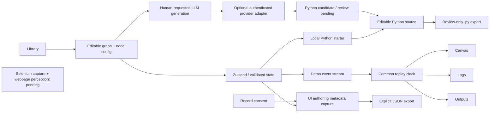

# SRE Flow Builder frontend

Editable, dark, multi-panel SRE workflow design environment for `llm-bot-selenium`. It is a **design and demonstration frontend**, not a production infrastructure runner.

```sh
cd ui
npm ci --include=dev
npm test
npm run dev                     # http://127.0.0.1:5173
npm run build
npm run preview                 # http://127.0.0.1:4173
```

Requires Node22+ and Python3 for the cross-language artifact test. The installed demo is at `http://smol-kitten.local:32085/` on the owner's LAN, not a public GitHub deployment.

## Individual components

| Component | Purpose and behavior |
|---|---|
| Top navigation | Editable project name; local Save; Run demo; **Record**; Schedule/Share explain their backend boundaries. |
| Component library | Search actions/integrations; drag or click to create nodes. Templates restores the base graph. |
| Workflow canvas | React Flow pan/zoom/minimap, snapping, drag/connect and click-connect, conditional Yes/No ports, delete and duplicate; ELK auto-layout loads on demand. |
| Node inspector | Target/region/metrics configuration, explicit Connect to control, prompt, outputs, error policies and **Python** implementation. |
| Python branch builder | Switch the reference error branch to an input comparison such as **i > 3**; set its numeric sample input. Generates a local Python starter from configuration, never pretending it came from an LLM. |
| Python source editor | Edit `def run(inputs, context=None)` for each node. Save/import/export retains source, origin and review status. Config changes never overwrite manual/LLM code; reset asks for confirmation. |
| LLM generation panel | Submit instructions to an optional authenticated server-side provider adapter; review returned source before export. With no provider configured it explicitly reports pending. Credentials do not enter workflow JSON. |
| Record / capture dialog | Explicitly consent to capture **UI-authoring metadata** (node selection, graph changes, timestamps). Pause/resume/stop/export works. Does not record keystrokes, field values, webpage contents, video or external browser actions. Memory-only until explicit export. |
| Browser / Preview / Variables | Labelled HTML Lambda fixture and runtime outputs. Live Selenium frames, real screenshots and webpage perception remain pending. |
| Playback | One common clock reconstructs node states, logs and output. Speeds affect recorded demo playback only. |
| Debugger | Real events from the deterministic demo, filtered by node/text. LLM tab shows observable summaries only. No fabricated network requests/screenshots. |
| Run history | Immutable demo graph snapshots; replay is read-only and does not rerun external actions. |
| Layout / persistence | Drag splitters; localStorage layout and explicit workflow Save/Load. JSON import validates bounded graphs/cycles/config. No server account storage. |

### Try Python-backed branching

1. Select **Any errors found?** and click **Use input i > 3** in Node Config.
2. Change the input name, comparison, threshold or demo value.
3. Open **Python**: see the generated `run(inputs, context=None)` starter with `i = inputs["i"]` and `i > 3`.
4. Edit the code directly. Source is stored with the node, survives JSON and explicit local Save, and can be exported as `.py`.
5. **Generate Python with LLM** requests a candidate, not execution or approval. Unconfigured deployments return pending.
6. Handwritten/model code is review/export only: the browser refuses to pretend a demo ran it. Declarative branch configuration is evaluated by constrained comparisons, not `eval`.

Backend counterpart (syntax validation and review-only export, **no exec**):

```sh
python -m triage.studio_python saved-sre-workflow.json --output workflow.py
python -m unittest discover -s tests -p test_studio_python.py -v
```

Syntax validation is not a security sandbox. Do not import or run unreviewed Python. Python export is an artifact, not a deployed DAG or workflow runner.

## Recording boundaries

Record captures interactions with this editor only. The record dialog names the scope before starting. A stopped JSON capture has `kind: ui-authoring` and `browserCapture: pending`. This avoids mistaking editor telemetry for a Selenium browser recording. The next browser adapter must supply observed actions, real frames, locator metadata and session ownership; page extraction/LLM selector discovery is explicitly pending.

## Optional code-generation adapter

`serve-template.ts` can use a server-configured OpenAI-compatible chat-completions endpoint. It requires:

- `SRE_CODEGEN_URL`: full HTTPS chat-completions endpoint (HTTP allowed only for loopback).
- `SRE_CODEGEN_MODEL`: configured model ID.
- `SRE_CODEGEN_API_KEY`: provider key, server only when needed.
- `SRE_CODEGEN_SERVICE_TOKEN`: frontend-to-service access token, separate from provider key.

Enter the service token in the Python panel; it stays in component memory, not saved workflow/capture. This is a LAN prototype adapter, **not production authentication/RBAC**. Use HTTPS and operator-managed authentication before real credentials or public exposure. No provider is enabled merely by installing this frontend.

The adapter checks same-origin browser requests, token authorization, request-size limits, a single in-flight generation and timeout, and returns a pending-review candidate. It never executes Python or invokes infrastructure. Without configuration it returns HTTP503/pending. Provider errors are sanitized.

## Genuine screenshots — capture pending

No screenshot images are checked in from this runtime: Chromium cannot start with its sandbox (`No usable sandbox`), and the alternate browser download timed out. The sandbox was not disabled. We deliberately do **not** substitute rendered illustrations or fabricated screenshots.

On a sandbox-capable development machine, build/serve the loopback demo and run:

```sh
python ui/scripts/capture_screenshots.py \
  --url http://127.0.0.1:4173/ \
  --binary /path/to/chrome --driver /path/to/chromedriver
```

The script uses an isolated temporary profile and the existing Selenium runtime without disabling browser security. It creates three real screenshots under `docs/images/`: `sre-flow-workspace.png`, `sre-flow-python-node.png`, `sre-flow-recording.png`. Add those actual images to the root README once captured. No broken image links or fake evidence are included.

## Files and state flow

- `src/App.tsx`: application shell, graph/panels, fixture browser, playback and inspector wiring.
- `src/sre.ts`: registry, editable graph schema, validation, connection helper and deterministic event-producing demo runner.
- `src/store.ts`: Zustand state, undo/redo, common execution clock and recording hooks.
- `src/python.ts`: config→Python starters, constrained branch comparisons, generation-request contract and source export.
- `src/PythonInspector.tsx`: branch fields, editable source, provenance/review and LLM request UI.
- `src/recording.ts`: bounded consented authoring capture and pause/resume/stop transitions.
- `src/workflow.ts`, `shared/`: earlier URL-seed IR and validation; SRE graph uses its own version1 schema. `SeedStudio.tsx` preserves the earlier experimental editor source, not an additional route.
- `triage/studio_python.py`: Python-side branch/config handling, AST syntax checks and review-only export.



## What is not implemented

Live Selenium recording/frames; LLM webpage perception; production integrations; a Python execution sandbox; WebSocket backend engine; PostgreSQL/Redis persistence; server workflow scheduling; production identity/RBAC. Parallel remains a configuration placeholder. For/while loops now have structured BODY/Continue/DONE semantics in the deterministic demo, not a production executor. Unreviewed code is never executed by this frontend or exporter.


## Control-flow and triage design expansion (PR11 review hold)

**PR11 remains unmerged pending owner review.**

### Structured loops, not arbitrary back-edges

- Templates → **For / While + IF / ELSE lab** provides a ready-to-run example. The loop variable changes each iteration and controls the nested branch.
- Adding **For / While Loop** creates a paired header, editable body placeholder and Continue boundary. The header has **BODY** and **DONE** output ports plus a **Repeat** input. The paired Continue return is a dashed purple edge.
- Configure `for` range (exclusive stop) or `while` comparison, initial value, variable, increment and an iteration cap (1–100). The cap is enforced, including wrong-direction while loops. Up to four nested body levels and a2500-event demo budget are bounded.
- Every body path must reach its paired Continue; malformed paths fail rather than silently finish. Deleting a boundary/header removes the paired control node while preserving authored body actions. Arbitrary cycles and invalid Continue destinations remain rejected.
- IF / ELSE cards show the predicate and both destinations. Each control port has one target; remove an existing edge before replacing it. Branch paths may converge into a shared next node.
- Python starters/exports reflect **for** versus **while**. Manual/LLM code is still review-only; the demo evaluates declared numeric controls, not arbitrary Python.

### Recorded/live triage → reusable browser snippet

1. Open the right-side **Triage** tab. Set an entry URL or URL template such as `https://example.com/ops?service={service}`.
2. Import `triage-session/v1` JSON, or explicitly load a labelled recorded fixture / demo live buffer. The live transport itself is pending; a live buffer can accept manual batches through the documented adapter seam.
3. Select **From** and **Through** events. The highlighted inclusive click path keeps source event IDs and rebases timestamps.
4. Name and save the snippet. The **Snippets** sidebar/library lets you insert an immutable per-node snapshot into any workflow. Parameter bindings are editable in the inspector; library entries and node snapshots survive workflow Save/Load and JSON export.
5. Snippet nodes show entry URL, step count, provenance and click path. Running one returns **Pending**, not a fabricated browser success. Live Selenium execution, video frames and webpage perception require the future adapter.

Imports are bounded and typed: unique ordered IDs, HTTP(S) URLs, no embedded credentials, redacted credential query fields, no URL fragments or typed-value/request-body payloads. Imported source claims are unverified. The editor's **Record** captures authoring metadata and is deliberately not treated as triage evidence. Explicit approval is requested before sending snippet metadata to a configured LLM.

Minimal import shape:

```json
{"version":"triage-session/v1","id":"session-001","mode":"recorded","url":"https://example.com/ops","events":[{"id":"nav","elapsedMs":0,"action":"navigate","url":"https://example.com/ops"},{"id":"metrics","elapsedMs":1200,"action":"click","url":"https://example.com/ops","locator":"[data-testid=metrics]"}]}
```

### VS Code-style pane dividers

All five boundaries now resize independently: library/canvas, canvas/right pane, canvas/inspector, browser/debugger, debugger/history. Splitters have visible grips, pointer capture, touch cancellation, keyboard arrows (Shift for larger steps), double-click/Home reset, minimum sizes and persisted dimensions. The canvas toolbar can restore a collapsed inspector or reset the whole layout. Saved layouts from the previous version migrate with defaults for new dividers.

New implementation files: `control.ts`, `ControlFlowEditor.tsx`, `snippets.ts`, `TriageDesigner.tsx`, `layout.ts`, `Splitter.tsx`. Tests include bounded loops and scoped branch variables, malformed returns/cycles, snippet sanitization/range/persistence, pane math, and actual server-rendered component markup. SSR is not a screenshot or browser-pointer acceptance test.
